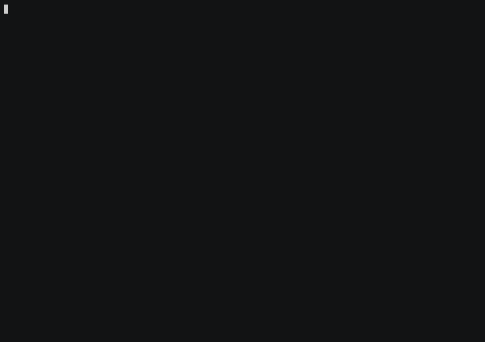
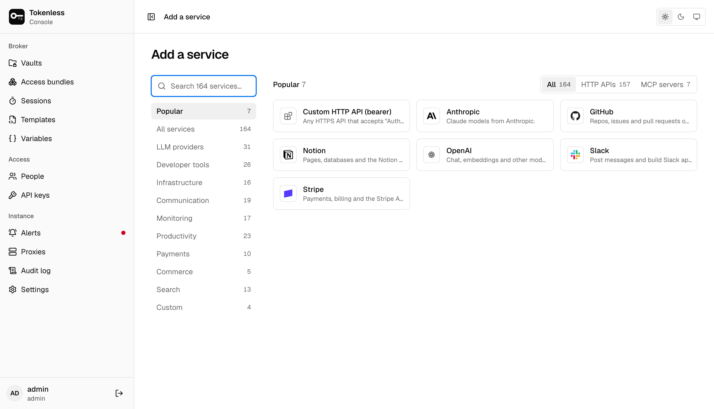
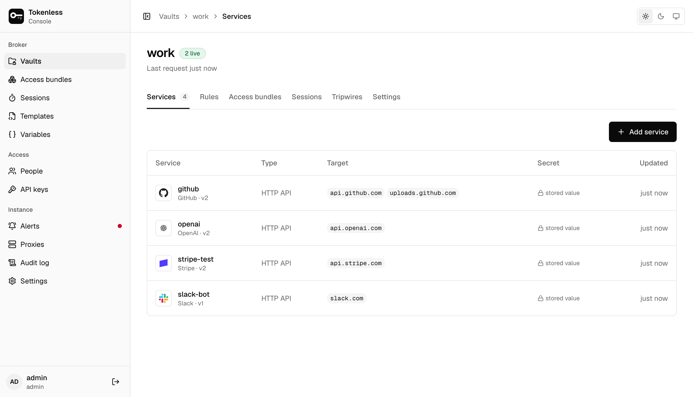
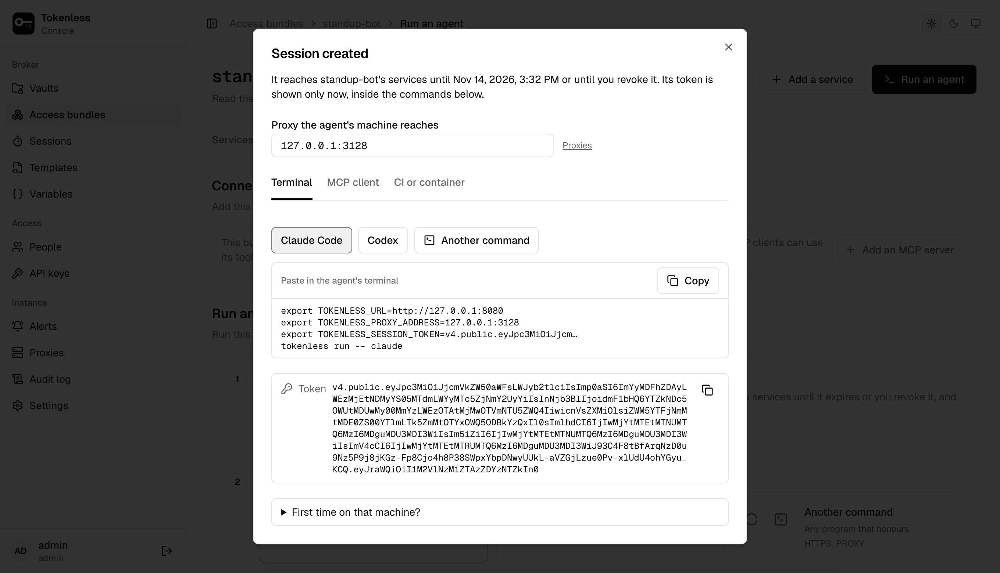
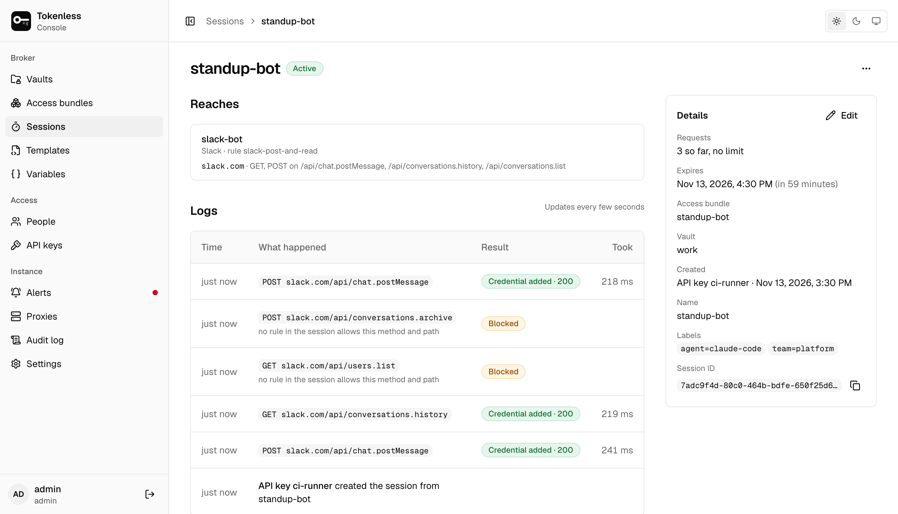
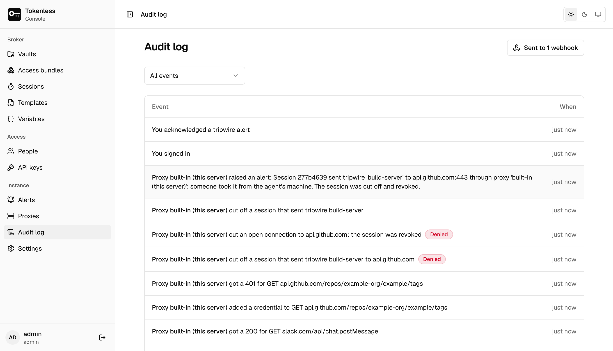

<!--
SPDX-FileCopyrightText: 2026 tokenless contributors
SPDX-License-Identifier: MIT OR Apache-2.0
-->

# tokenless

A credential broker for AI agents. Agents send HTTPS traffic through a
local forward proxy using a short-lived session token. For hosts that
have a rule, the proxy terminates TLS and injects the real credential.
The agent never sees it. Every other host is tunnelled untouched (or
denied, depending on policy).



- **Write-only secrets.** Credentials are encrypted at rest with
  AES-256-GCM. Nobody, admins included, can read one back.
- **Scoped, short-lived sessions.** Each session is a PASETO v4.public
  token bound to a vault, a subset of rules, a TTL (15 min by default,
  1 h maximum), an optional request limit, and audit labels. Revocation
  reaches the proxy within seconds.
- **Access bundles and a launcher.** Group a vault's rules by job
  (`code-review`) and start an agent with
  `tokenless run --bundle code-review -- <agent>`: the agent gets
  a local proxy address, never a token.
- **Fails closed.** The proxy runs from an Ed25519-signed, leased policy
  snapshot. When the lease lapses it refuses traffic, and it refuses to
  inject when it cannot record an audit event.
- **No pivoting into private networks.** By default the proxy will not
  tunnel to loopback, private, link-local or metadata addresses. Allow
  specific ranges in **Settings**.

The design, the threat model and the trade-offs are in
[docs/adr/0001-architecture.md](docs/adr/0001-architecture.md).

## A tour of the console

**1. Pick a service.** Over 150 are built in, from LLM providers to
payments, each knowing its hosts and how to send the key. Anything else
is a custom HTTP API or MCP server.



**2. Paste the token, once.** It is encrypted and write-only from then on.
A vault lists each service and the hosts it covers; nobody, admins
included, sees the secret again.



**3. Run an agent.** Group the services a job needs into an access bundle
and copy the commands that start the agent behind it
(`tokenless run -- claude`). The agent gets a local proxy address, never
a token. MCP clients get a URL instead.



**4. Watch what it does.** Each session's page lists its requests as they
happen: the credential added and the API's answer, or why the proxy
blocked a request outside the bundle's rules.



**5. Keep the record.** Every change, and every request the proxy adds a
credential to or refuses, is in the audit log, which can also be sent to
a webhook.



## Install

```sh
curl -fsSL https://raw.githubusercontent.com/gotempsh/tokenless/main/site/install.sh | sh
```

The script installs the latest release for Linux (x86_64, arm64) or macOS
after checking it against the release's `SHA256SUMS` (and its Sigstore
signature when `cosign` is installed). Releases also ship a signed
container image, `ghcr.io/gotempsh/tokenless`. To give your agents the
[agent skill](#the-agent-skill):

```sh
npx skills add gotempsh/tokenless
```

The documentation, including production deployment, is in
[`site/docs/content`](site/docs/content) and published with the website.

## Quickstart

To build from source instead, you need Rust 1.89+ and [bun](https://bun.sh).
Build the console first: it is embedded in the binary.

```sh
(cd broker-ui && bun install && bun run build)
cargo build --release

# Start it. On first start it prints the admin's password, once.
./target/release/tokenless serve --data-dir ./data
```

`serve` runs the control plane and a proxy for agents on the same machine
(`127.0.0.1:3128`), listed under **Proxies** as *built-in (this server)*.
A server whose agents run on other machines starts with `--no-proxy`
(or `TOKENLESS_NO_BUILTIN_PROXY=1`) instead; see [One server, many hosts](site/docs/content/server.mdx).

Save the username and password it prints; only a hash is stored. If you
lose it, `tokenless admin reset-password --data-dir ./data` on the same
machine prints a new one.

From the terminal:

```sh
tokenless status                                  # what is set up, and what to run next
tokenless login                                   # session kept in the OS keychain
tokenless service add github --vault work --bundle code-review   # asks for the token
```

`service add` creates the vault and the bundle when they don't exist,
stores the token encrypted and write-only, and adds a rule for it to the
bundle. An agent can run it for you without seeing the token:
`--secret-file` waits for you to save it in a private file and deletes the
file once it is stored, `--web` waits for you to enter it in the console. `tokenless service
templates OPENAI_API_KEY` finds a template by the variable a tool reads.
See [Set up from the terminal](site/docs/content/terminal.mdx).

Or in the console at <http://127.0.0.1:8080/>:

1. Sign in. Under **Account**, change the password and, optionally but
   recommended, turn on an authenticator app (TOTP).
2. **Vaults → Create vault**.
3. **Credentials → Add a credential**. Pick a template (for example
   GitHub) and paste the token. The form is write-only.
   Use **Test** next to it to send the template's validation request
   (status code only, to the credential's own host).
4. **Rules → Add a rule** for that credential. Leave the scope empty to
   use the template's maximum, or narrow it.
5. **Access bundles → Create bundle**, for example `code-review`, and
   tick the rules an agent doing that job needs.
6. For agents on another machine, **Proxies → Add a proxy**, then on
   that machine:

   ```sh
   tokenless node join --control-url https://<server>:8443 --token 'cbj1....' --state ./node.json
   tokenless node run --state ./node.json
   ```

7. Optionally, **People → Invite someone** as `viewer`, `editor` or
   `admin`, and send them the one-time link.

### Run an agent with an access bundle

An agent's credential is a **session**: a token that reaches one bundle's
services until it expires (up to **Settings → Session lifetime**, 7 days
by default) or is revoked, optionally capped at a number of requests.
Create one under **Sessions → New session** (or on the bundle's page), give the
token to the agent's machine, and start the agent:

```sh
export TOKENLESS_SESSION_TOKEN=v4.public...   # or --session-token-file
tokenless run -- claude
```

Signed in with `tokenless login`, `run` can instead mint a session from
the bundle for this one run, renew it while the agent runs and end it when
the agent exits:

```sh
tokenless run --vault work --bundle code-review -- claude
```

`run` opens a **session port**: a
loopback proxy address (a free port by default, `--listen` to choose)
that adds the session to every request and relays it to the proxy. The
agent is started with `HTTPS_PROXY=http://tokenless:<password>@127.0.0.1:<port>`
(a password made up for the run, so no other program on the machine can
use the session), trust files
that include the broker's interception CA (`SSL_CERT_FILE`,
`NODE_EXTRA_CA_CERTS`, `REQUESTS_CA_BUNDLE` and others), and no session
token anywhere in its environment. A session it minted is renewed before
it expires and ended when the agent exits; a session it was given is used
as is. `run` exits with the agent's code.
`run` prints nothing of its own, so what you read is only the agent's
output; add `-v` to see the session, the session port and the proxy it
used.
The agent never inherits `TOKENLESS_SESSION_TOKEN`, `TOKENLESS_API_KEY` or
`TOKENLESS_SESSION_TOKEN` from your shell.

#### Filling environment variables

`exec` is `run` with variables filled by reference, for scripts that read
a key from the environment:

```sh
tokenless exec --bundle deploy \
  GITHUB_TOKEN=cb://github/token REGION=eu-west-1 -- ./release.sh
tokenless exec --bundle deploy --env-file .env.broker -- ./release.sh
```

`cb://<service>/<field>` is replaced by that field's
[placeholder](#placeholders), which the proxy swaps for the secret on the
service's hosts. The command never holds the secret, because nothing can
read a stored secret back. `<service>` is the service, rule or template
name, and `/<field>` can be left out when the service has a single
placeholder. Other values are passed through as written. An env file holds
the same `NAME=value` lines, so it can be committed. Later files and
arguments override earlier ones, and nothing may override the proxy or
trust variables. A reference that resolves to nothing stops the run before
the command starts, with the references the session does resolve.
`session info` prints each placeholder's reference.

#### The agent skill

```sh
npx skills add gotempsh/tokenless                # with the skills CLI, for any agent
npx skills add git@github.com:gotempsh/tokenless.git  # or any git URL, with your git credentials
tokenless skill --install                        # ~/.agents/skills (Codex and others), linked from ~/.claude/skills
tokenless skill --install --project              # for one project
tokenless skill                                  # print it
```

The skill ([`skills/tokenless/SKILL.md`](skills/tokenless/SKILL.md))
tells an agent behind the broker how to see what it can reach, what to
give a tool that insists on a key (a placeholder when the service has one,
any dummy value when it doesn't), and read the proxy's and the MCP
gateway's refusals without trying to work around them. An agent not yet
behind the broker uses it to offer a vault when a key comes up, and to
walk the user through `tokenless service add` without seeing the key.
It is built into the binary, so
it always matches the CLI. A copy with local edits is only replaced with
`--force`.

To keep a session port open for agents you start yourself:

```sh
./target/release/tokenless session start --bundle code-review \
  --listen 127.0.0.1:17323 --env-file ./agent.env
# in the agent's shell:
. ./agent.env && curl https://api.github.com/user
```

It prints the same exports, renews the session, and ends it on Ctrl-C
or SIGTERM. For scripts that manage the token themselves:

```sh
TOKEN=$(tokenless session create --bundle code-review --ttl 15m)
HTTPS_PROXY="http://$TOKEN@127.0.0.1:3128" curl --cacert broker-ca.pem https://api.github.com/user
TOKENLESS_SESSION_TOKEN=$TOKEN tokenless session revoke
```

Through any of these, the request reaches GitHub with
`Authorization: Bearer <stored token>`. Any `Authorization` header the
agent sent is replaced, requests outside the bundle's rules get `403`
with the reason, and requests without a valid session get `407`.

#### Placeholders

Some APIs want the key in the query string, the URL path or the body, and
some tools refuse to start without a key. Give the service a placeholder
under **Services → Placeholders** (`PUT /api/v1/credentials/{id}/substitutions`):
the agent sends `__GITHUB_TOKEN__` and the proxy swaps in the real value
on its way to that service's hosts, and nowhere else. Each placeholder
says where to look: headers the agent sends, the query, the path (values
are percent-encoded, so they stay inside one segment) or the body (JSON
is escaped, forms are encoded; compressed bodies, bodies over 4 MiB and
bodies of unknown length are forwarded untouched, and the session log
says so). A placeholder with an environment variable is exported by
`run` and `session start`, e.g. `GITHUB_TOKEN=__GITHUB_TOKEN__`.

An agent can ask what its session reaches:

```sh
tokenless session info           # behind run/session start: asks the session port
curl "$TOKENLESS_PROXY/services" # the same, as JSON
```

It lists the bundle, each service's hosts, allowed methods and paths,
and its placeholders, never a secret. With only a token, `session info`
uses `GET /api/v1/sessions/self` and `TOKENLESS_SESSION_TOKEN`.

| Setting | Flag | Environment |
|---|---|---|
| Management API | `--server` | `TOKENLESS_URL` (default `http://127.0.0.1:8080`) |
| Session token | `--session-token-file` | `TOKENLESS_SESSION_TOKEN` (instead of minting from `--bundle`) |
| API key | `--api-key-file` | `TOKENLESS_API_KEY` (or the `tokenless login` session) |
| Vault | `--vault <name or id>` | `TOKENLESS_VAULT` (not needed with a vault-bound key) |
| Bundle | `--bundle <name or id>` | `TOKENLESS_BUNDLE` |
| Proxy | `--proxy host:port` | `TOKENLESS_PROXY_ADDRESS` (default `127.0.0.1:3128`) |

Pass `--ca-fingerprint` with the SHA-256 shown on the **Proxies** page
to refuse to start if the broker presents a different CA. The session
port only binds loopback addresses, because anything that can reach it
uses the session; on a shared machine, other local users can too.

A bundle is a convenience over picking rules, not a grant of its own:
a session keeps the rules it was minted with, and disabled rules are
skipped when minting. To cut a running agent off, revoke its session,
disable the rule, or delete the bundle, which also ends every live
session minted from it. Session labels can be changed afterwards
(`PATCH /api/v1/sessions/{id}`); traffic records keep the labels the
session was minted with. Holding a session's token is enough to end that
session (`POST /api/v1/sessions/revoke-self`).

Each session has its own page (**Sessions**, or the bundle's Sessions
tab): every request it made, what the proxy did with it and what the API
answered, and its history (who created it, relabelled it or revoked it).

### Connect an MCP client

MCP clients that take a server URL (Claude Code, Cursor and others) use
the proxy's **MCP gateway** instead of `HTTPS_PROXY`. `node run` serves it
on `127.0.0.1:3129` (`--mcp-listen` to move it, `--no-mcp-gateway` to turn
it off). Each MCP server in a bundle gets a URL of the form
`http://127.0.0.1:3129/mcp/<host>/<path>`, and the client sends a session
token as its bearer token:

```sh
tokenless mcp --bundle code-review                # prints claude mcp add ... per server
tokenless mcp --bundle code-review --format json  # an mcpServers block for other clients
```

`mcp` mints one session for the bundle, lasting as long as **Settings →
Session lifetime** allows (`--ttl` for less), and prints commands like:

```sh
claude mcp add --transport http github http://127.0.0.1:3129/mcp/api.githubcopilot.com/mcp/ \
  --header 'Authorization: Bearer v4.public...'
```

The bundle's **Connect** tab does the same from the console. The gateway
checks the token against the node's snapshot and removes it, then
forwards the request over TLS exactly as an intercepted tunnel would: the
same rule match, credential, MCP tool allowlist and audit records. It only
reaches hosts the session's rules cover. The client stores the session
token, never a service credential, so ending the session (Sessions page,
`tokenless session revoke --id ...`, or deleting the bundle) cuts
it off within one snapshot. Only the streamable HTTP transport is
supported; the older SSE transport's endpoint URLs would bypass the
`/mcp/<host>` prefix. See [ADR 0003](docs/adr/0003-mcp-gateway.md).

### Automation

Scripts that manage a vault use an API key (`editor` or `viewer`, one
vault, **API keys → Create API key**). An editor key can create sessions
over the API, by bundle or by rules:

```sh
curl -s -X POST http://127.0.0.1:8080/api/v1/vaults/<vault-id>/sessions \
  -H "Authorization: Bearer cbk_..." -H 'content-type: application/json' \
  -d '{"bundle":"code-review","ttl_secs":900,"labels":{"agent":"build-bot"}}'
```

### Deployment notes

- To run tokenless on a server and connect the machines that run agents to
  it, follow [One server, many hosts](site/docs/content/server.mdx); the
  server side is the Compose recipe in
  [`examples/docker-compose`](examples/docker-compose).
- The management API serves plain HTTP on loopback by default. For
  anything beyond `localhost`, serve HTTPS directly or put a
  TLS-terminating reverse proxy in front, because the session cookie is
  `Secure`:

  ```sh
  ./target/release/tokenless serve --data-dir ./data \
    --api-listen 0.0.0.0:443 --api-tls-cert /etc/broker/fullchain.pem --api-tls-key /etc/broker/privkey.pem
  ```

  The certificate files are checked every minute and reloaded when they
  change, so a renewal does not need a restart.
- Validation requests to a self-hosted service with a private CA need
  `--validation-ca ca.pem` (repeatable). If the service is on a private
  address, also allow that range under **Settings → Egress to private addresses**.
- Use `--node-listen` and `--node-api-name` to expose the node API on a
  private address.
- Keep the proxy listener (`node run --listen`, or `serve --proxy-listen`
  for the built-in one) on loopback or a private network.
- Secrets are encrypted under data keys, which are encrypted under a
  root key the database never holds. Keep the root key outside the data
  directory: `--root-key-file /etc/tokenless/root.key` (create one with
  `openssl rand -base64 32`) or `TOKENLESS_ROOT_KEY`. Without it, `serve`
  creates `data/root.key` and warns at every start. Back up the database
  and the key separately. See
  [Deploy → The root key](site/docs/content/deploy.mdx#the-root-key).
- Logs are JSON lines on stdout. Set `RUST_LOG` (for example
  `RUST_LOG=debug`) to change the level.
- Data plane metrics are exposed in Prometheus format with
  `node run --metrics-listen 127.0.0.1:9090`.

## Development

```sh
cargo build
cargo clippy --all-targets -- -D warnings
cargo test                      # unit tests, conformance suites, end-to-end test
(cd broker-ui && bun run typecheck && bun run build)
(cd broker-ui && bun run dev)   # UI dev server, proxies /api to 127.0.0.1:8080
```

`cargo build` embeds `broker-ui/dist` when it exists; `serve --ui-dir
broker-ui/dist` serves a directory instead, which is handy while working
on the console.

### Releasing

1. Set `version` in the root `Cargo.toml` (and `broker-ui/package.json`)
   and push it to main. That starts **Release cache**, which compiles the
   release targets' dependencies on main, where a tag can restore them;
   when it finishes, tag the commit: `git tag -s v0.2.0 && git push origin
   v0.2.0`. Tagging sooner still works, only slower.
2. The **Release** workflow checks the tag matches `Cargo.toml`, builds the
   console and the four platform archives, signs them with Sigstore,
   attests their provenance, publishes the GitHub release, and pushes the
   signed multi-arch image to `ghcr.io`. A tag with a suffix
   (`v0.2.0-rc.1`) is a prerelease and doesn't move `latest`.

The website (`site/`) is deployed separately; see
[`site/README.md`](site/README.md).

| Path | Contents |
|---|---|
| `crates/tokenless-core` | Rules, scopes, templates, injection, sessions, snapshots (no I/O) |
| `crates/tokenless-auth` | Passwords, TOTP, tokens, CSRF, cookies |
| `crates/tokenless-control` | Services and the store / authorizer traits |
| `crates/tokenless-conformance` | Suites every trait implementation must pass |
| `crates/tokenless-dataplane` | The forward proxy and node client |
| `crates/broker-server` | HTTP APIs, SQLite store and the `tokenless` binary |
| `broker-ui` | Management console |
| `tools/catalog` | Source of the built-in service catalogue and its logos |
| `site` | Website: the documentation (`site/docs`) and `install.sh` |
| `packaging` | The release container image |
| `skills/tokenless` | The agent skill (`npx skills add`, `tokenless skill`) |

### Adding a built-in service

The built-in templates and their logos are generated from
`tools/catalog/services.toml`; never edit `crates/tokenless-core/templates/`,
`builtin_catalog.rs` or `broker-ui/src/assets/logos/` by hand.

```sh
tools/catalog/fetch-sources.sh       # once: pinned logo sets into tools/catalog/.cache
# add a [[service]] entry to tools/catalog/services.toml (keys documented at its top)
python3 tools/catalog/generate.py    # templates, builtin_catalog.rs, logos and NOTICE.md
python3 tools/catalog/generate.py --check   # what CI should run: fails if anything is stale
```

A logo is found automatically by name in svgl, Lobe Icons, Simple Icons and
gilbarbara/logos, in that order; pin one with `icon = "simple:slug"` or opt
out with `icon = "none"`. Each logo's source and licence is recorded in the
generated `broker-ui/src/assets/logos/NOTICE.md`. Templates are seeded once per
id and version, so bump `version` whenever you change what an existing
service injects or allows.

## License

Licensed under either of [Apache License, Version 2.0](LICENSE-APACHE) or
[MIT license](LICENSE-MIT), at your option.
