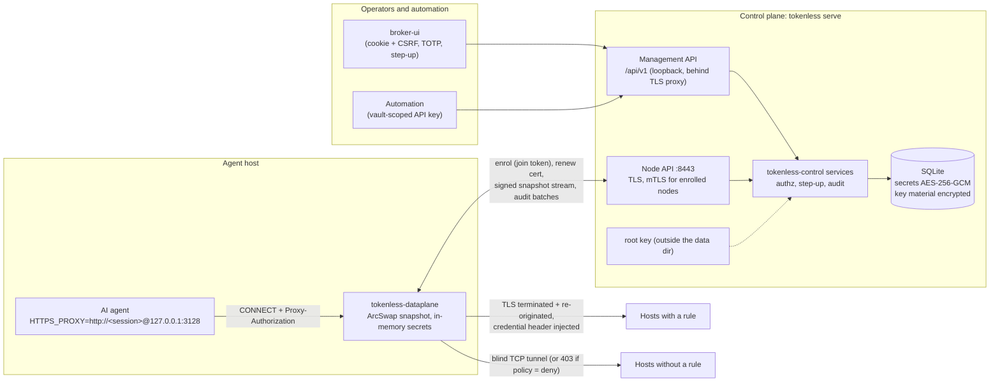
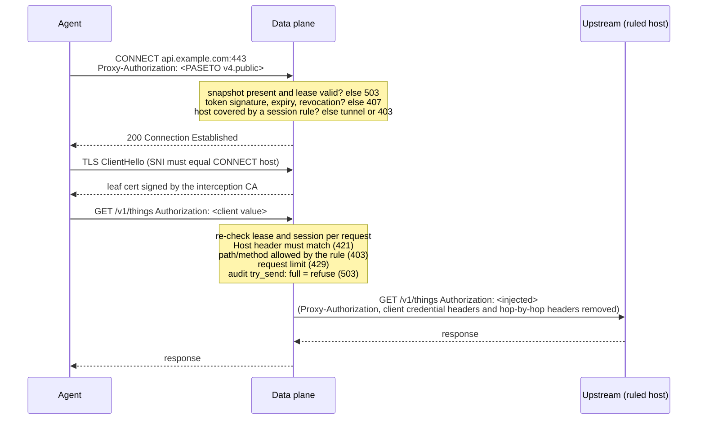
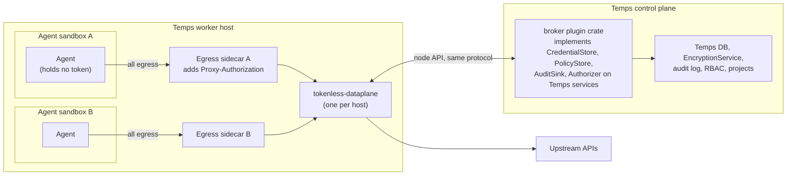

<!--
SPDX-FileCopyrightText: 2026 tokenless contributors
SPDX-License-Identifier: MIT OR Apache-2.0
-->

# ADR 0001: Architecture of the credential broker

- Status: accepted (MVP)
- Date: 2026-11-06

## Context

AI agents need to call third-party APIs (source hosting, payments, model
providers, internal services) but should never hold the long-lived secrets
those APIs require. A leaked prompt, log line, or compromised dependency
inside the agent's sandbox must not be able to exfiltrate a credential.

The broker solves this by sitting on the agent's egress path. It is an
HTTPS forward proxy that, for a small set of hosts covered by explicit
rules, terminates TLS and **injects** the credential into the request. The
agent only holds a short-lived, narrowly scoped proxy session token.

The broker must run standalone on a small machine (4 GB RAM / 3 vCPU), and
must later embed natively into Temps without the core ever depending on
Temps.

## Decision

### One data plane, several control planes

The data plane is identical in every deployment mode. Only the control
plane behind it changes. Temps will depend on the broker; the broker never
depends on Temps.

| Crate | Role | I/O |
|---|---|---|
| `tokenless-core` | Rules, opaque scopes, host/path/method matching, template schema, injection methods, PASETO session claims, snapshot signing, sealed envelopes, RBAC decisions, wire protocol | none |
| `tokenless-auth` | argon2id passwords, TOTP, token generation and hashing, CSRF tokens, session cookies | none |
| `tokenless-control` | Services behind the traits `CredentialStore`, `PolicyStore`, `AuditSink`, `Authorizer` (plus `IdentityStore` and `NodeStore` for standalone), at-rest cipher, internal PKI, key ring | via traits only |
| `tokenless-conformance` | Behavioural test suites any trait implementation must pass | none |
| `tokenless-dataplane` | hyper + rustls + rcgen forward proxy, node enrolment client, snapshot stream, audit batcher | network |
| `broker-server` | axum binary: management API, node API, SQLite store, root key, CLI | network, disk |
| `broker-ui` | Vite/React console | browser |

### Standalone mode

### Request path through the data plane

Hot path guarantees:

- Rules, keys and revocations come from an `ArcSwapOption<ActiveSnapshot>`.
  A request performs no database, network, or disk access before
  forwarding. Nothing on the request path takes a `Mutex`.
- Interception leaf certificates are generated when a snapshot is applied,
  never per connection. They are reused across snapshots while the CA is
  unchanged and they are under 24 hours old.
- Each intercepted tunnel has one upstream connection, owned by a small
  actor task, so no lock is shared between requests.
- Audit uses a bounded channel (default 4096) fed by `try_send`. A batcher
  flushes 256 events or every 500 ms. When the channel is full, injection
  is refused with 503 and `broker_dataplane_audit_dropped_total` is incremented. The broker
  never injects without an audit record.
- An audit event counts as recorded once the control plane accepts its
  batch. Until then it lives only in the data plane's memory: a crash
  loses up to the queue's capacity plus the batch being shipped. The
  bound is deliberate; a disk queue would add I/O to the request path.
  What a crash can lose is limited by what the queue may hold, and
  injection stops once it is full, so a control plane that is down for
  long stops injection rather than growing the loss.
- `DataPlane::shutdown(drain)` stops in order. The listeners close and a
  binding refuses new connections; open tunnels and MCP gateway streams
  may finish, idle, intercepted and gateway connections close once their
  requests in flight answer, and
  snapshots keep arriving, so a revocation still cuts. At the deadline
  whatever is open is cut and audited as cut, the audit queue gets one
  last shipping attempt of up to 2 s, and the returned report says how
  many connections were cut and how many audit events never shipped.
  `tokenless node run` drains for `--drain-secs` (30 s by default) on
  Ctrl-C or SIGTERM; a second signal stops at once.
- Connection count is bounded (default 4096) by a semaphore with
  `try_acquire`. Excess connections are dropped rather than queued.

Expected footprint on the reference box: each idle tunnel costs a few KB
of hyper/rustls buffers, the snapshot is proportional to the number of
rules, and the audit queue is bounded at 4096 events. At saturation the
proxy drops new connections and refuses injection; it never buffers
without bound.

### Temps-native mode

In native mode a per-sandbox egress sidecar attaches the session token,
so the sandbox itself never sees it, not even in an environment variable.
There is one data plane per host, shared by every sandbox on it. The
control plane is a Temps plugin that implements the four traits on Temps'
own services and passes `tokenless-conformance`. The data plane binary, the
node protocol and the snapshot format are unchanged.

### Deployment modes

1. **Standalone.** `tokenless serve` runs on its own host or VM.
   The management API either serves TLS itself (`--api-tls-cert` and
   `--api-tls-key`, reloaded when the files change) or listens on loopback
   behind a TLS-terminating reverse proxy. The node API listens on a
   private address, and one
   `tokenless node run` runs next to each agent runtime.
2. **Standalone, hosted as a Temps project.** Only the server and UI are
   deployed behind Temps' HTTP proxy, which applies TLS and the project's
   IP allow rules. The data plane does **not** go through Temps' proxy,
   because that proxy has no CONNECT support. It runs on the agent hosts
   and is exposed on a private port (loopback or the private network). The
   node API (TLS with mTLS for enrolled nodes) is published on a private
   address only, not through the HTTP proxy, because it needs its own TLS
   termination to read client certificates.
3. **Native.** As in the diagram above: the plugin control plane, a
   per-host data plane, and per-sandbox sidecars.

### Authentication

**People (UI)**

- Local accounts with argon2id passwords (19 MiB, t=2, p=1, minimum 12
  characters) and, per account, an optional TOTP authenticator. An
  account without one signs in with its password and is not asked to
  step up, since that would only ask for the same password again. An
  account with one must present a code at sign-in and for step-up: its
  password is never accepted in place of the code. The People page marks
  password-only accounts.
- TOTP steps are recorded with a compare-and-set, so a code cannot be
  replayed.
- The session token is random and stored only as a SHA-256 hash. It is
  sent as `__Host-broker_session` with `HttpOnly; Secure; SameSite=Strict`.
  Every mutating request must carry `X-CSRF-Token`, which is
  `HMAC-SHA256(csrf_key, session_hash)`.
- Step-up: creating or widening credentials, creating rules, widening or
  re-enabling rules, and managing people, API keys, templates and nodes all
  need a TOTP verification within the last 300 s for accounts with an
  authenticator. Login counts as one. Password-only accounts are not
  gated, so enrolling an authenticator is what makes these actions need a
  fresh second factor.
  `POST /auth/step-up` refreshes it, and the UI prompts for the code and
  retries the blocked request.
- The first admin, `admin`, is created on first start with a generated
  password (four groups of five characters, about 99 bits). It is printed
  to the terminal once (deliberately not to the structured log) and stored
  only as an argon2id hash; when two servers race, the store's uniqueness
  check lets one win. `tokenless admin reset-password`, run against the
  data on the server's host, replaces a lost password and ends that
  account's sessions. It needs no network path, so possession of the host
  is the recovery factor.
- Further people join by invitation. An admin creates a single-use
  `cbinv_` link for the `admin`, `editor` or `viewer` role, valid for 1 h
  to 7 days and stored only as a hash. The invitee chooses a username and
  password and enrols TOTP without a session; accepting consumes the
  invite and creates the user in one transaction. Roles are
  instance-wide.
- An admin can change a person's role or disable them. Disabling deletes
  their UI sessions, and login and session checks refuse disabled users.
  The store refuses, under its write lock, any change that would leave no
  enabled admin, so two admins cannot demote each other at once.
- Login failures are rate limited to 5 per username per 5 minutes.

**Automation**

- API keys have the form `cbk_<12-char prefix>_<secret>`. The prefix is
  the lookup key and the secret is stored only as a hash.
- Each key is bound to one vault and one role (`editor` or `viewer`;
  never admin) and has an expiry. Agents are not given API keys: their
  credential is a session token (see Sessions). An earlier
  `session_issuer` role for agents' launchers was removed, and its keys
  deleted, when sessions became something people create and hand over.
- A key is returned once, with `Cache-Control: no-store`. Every API
  response is `no-store`.
- API keys can never satisfy step-up.

**Nodes**

- A join token has the form `cbj1.<id>.<secret>.<node CA SHA-256>`. It is
  single use and expires.
- During enrolment the node pins the node CA from the token. It generates
  its own TLS key (as a CSR) and its own X25519 sealing key; neither
  leaves the node.
- The control plane signs a client certificate that is valid for 24 h and
  carries SAN `urn:tokenless:node:<id>` and the clientAuth EKU.
  Nodes renew it at two thirds of its lifetime.
- Every node API call checks the node's revocation flag in the store, so
  revocation is immediate even though the certificate stays
  cryptographically valid until it expires.
- Snapshots are Ed25519-signed over
  `tokenless/snapshot/v1\0 || body`. They carry a strictly
  increasing version (persisted counter; nodes reject `<=` current), a
  node id, and a lease, which is 60 s by default.
- Without a newer snapshot before the lease runs out, the data plane
  refuses all traffic (503), both on new CONNECTs and on requests inside
  existing tunnels. The server sends a snapshot on every policy or session
  change, and at least every `lease/3`.
- Traffic already flowing is cut when its session is taken back: a
  passthrough tunnel, an intercepted connection (idle or mid-response) and
  an MCP gateway response that is still streaming are closed when a
  snapshot lists the session as revoked, when the binding it came through
  is revoked, when the lease runs out, or one hour
  (`OPEN_TRAFFIC_GRACE_SECS`) after the session expired. A revocation
  therefore reaches open traffic within one snapshot push while the node
  is connected, and within the lease otherwise.
- Expiry itself stops only new traffic, because the holder has usually
  renewed (`tokenless run` mints the next session before the current one
  ends and keeps relaying tunnels opened under the old one). An
  intercepted connection closes gracefully at expiry once its requests in
  flight have finished, and the client reconnects with its current
  session; a passthrough tunnel or a streaming response runs on for up to
  the grace hour. So that a revocation still reaches that traffic, a
  revoked session stays in snapshots until an hour after it expires,
  deleting a vault or bundle revokes its sessions that expired within the
  hour, and a holder can revoke its own session with an expired token.
- Snapshot bodies and session claims reject unknown fields. A new field
  that changes a security decision raises the snapshot `format` (claims
  rely on the unknown-field refusal), so a node too old to enforce it
  refuses the snapshot or session instead of ignoring the field: it fails
  closed. A snapshot is written in the oldest format that carries
  everything in it, and a node opens the snapshot stream with the newest
  format it reads (`?reads_format=`, absent on nodes older than format 2,
  which read format 1). A rule that needs a newer format is left out of
  that node's snapshot, so an older node stops using that one service and
  serves the rest, and the control plane logs which node it is. Either
  upgrade order is therefore safe: the control plane first, as the
  deploy guide says, costs only the services that use a new feature on
  the proxies not yet upgraded. Format 2 adds a credential's `not_after`.
- An embedded data plane is scoped: its snapshot holds only the rules of
  live sessions minted for it (`node_id`), not every enabled rule, so a
  compromised worker holds sealed credentials only for the workloads it
  runs. Minting such a session triggers a new snapshot, and the embedder
  waits for it with `Binding::ready`. Rules leave when their sessions are
  revoked or expire. Enrolled nodes still receive every enabled rule, so
  sessions without a node work on any of them.
- A credential whose secret expires upstream (an installation token, say)
  carries that deadline, set with the secret and replaced with it. The
  node stops injecting it then and answers 503 `credential_expired`, so a
  stale secret is never sent; it works again once whoever manages it
  replaces the secret. Issuing and refreshing such secrets is the
  embedder's job.
- Credentials and the interception CA key are sealed to the node's X25519
  key: ephemeral X25519, then HKDF-SHA256, then AES-256-GCM, with AAD
  binding node, rule and credential. Nodes hold them in memory only;
  `node.json` stores the node's own keys, not credentials.

**Secrets are write-only**

No API returns a credential's value: there is no read endpoint, and the
metadata type cannot carry one. Values are encrypted with AES-256-GCM
under the vault's data key, with AAD bound to the credential and vault
ids. Data keys are wrapped by an instance key stored in the database,
which is wrapped by a root key the operator supplies (`--root-key-file`
or `TOKENLESS_ROOT_KEY`) and the database never holds; replacing the
root key re-wraps one row.
Rotation replaces the value and returns metadata only. The end-to-end test
checks every read endpoint and the raw database files for the plaintext.

### Proxy sessions

- A session token is PASETO `v4.public` (Ed25519). The footer carries a
  `kid`, and the implicit assertion is
  `tokenless/proxy-session/v1`.
- Claims: `jti`, the vault scope (opaque), rule ids (a subset of the
  vault's rules), `iat` and `exp` (TTL default 15 min, max 1 h), an
  optional request limit, and audit labels.
- Two optional claims restrict where a session works. `aud` names the
  only node that accepts it. `sub` names a binding,
  `<binding id>/<generation>`: a host that embeds the data plane binds
  each workload it does not trust to that workload's sessions and serves
  its connections through the binding. Such a session works only through
  its binding, never from a `Proxy-Authorization` header, and a binding
  ignores that header and takes no other session. A workload restarted
  under the same id gets a new generation, so its old sessions stop
  working. Revoking a binding cuts every connection it opened.
- A binding holds one session per group of services that share a
  deadline, so one service can end while the others keep working. No two
  of its sessions may cover the same host, so one session's credential is
  never used under another's rules. `bind` refuses them when the snapshot
  in force already holds their rules. On a scoped node the rules arrive
  after the mint, so the binding's status reports `overlapping_sessions`
  once they do, `Binding::ready` fails with it, and a request to that
  host is refused. Deadlines are
  absolute: a mint's `not_after` caps the session's `exp`, and no session
  is minted once it has passed, so the embedder that owns a grant passes
  its deadline on every renewal and a renewal never extends it.
- An embedder reads the data plane's state rather than its logs:
  `DataPlane::status()` gives the snapshot version, the lease and, for
  each binding, its connections, each session's expiry and the last
  upstream failure (unreachable, or a 401 to the injected credential).
  Every "cannot carry traffic" has a typed reason (provisioning, stale
  policy, not configured, expired, revoked, binding revoked, invalid
  session, overlapping sessions) taken from the proxy's own checks. `DataPlane::events()` is a
  `watch` of the latest status, updated on each change, including a
  lease or session running out, so nobody polls; `Binding::ready`
  resolves once a given snapshot is in force and every session of the
  binding can be used. None of it holds a token or a secret.
- The data plane verifies sessions locally. Revocations arrive in the next
  snapshot; with the stream, that takes about one round trip.
- Clients use `HTTPS_PROXY=http://<token>@host:port`. Both the Basic form
  (as reqwest and curl send it) and `Bearer` are accepted.
- The proxy listens on `127.0.0.1:3128` by default and warns if bound
  elsewhere.
- Status codes:

  | Situation | Status |
  |---|---|
  | No snapshot yet, lease expired, audit queue full, or a limited session not yet provisioned | 503 |
  | Session missing, malformed, badly signed, expired, or revoked | 407 |
  | Plain HTTP, no rule for the method or path, or unmatched host with policy `deny` | 403 |
  | Through a binding: no valid session, or two sessions cover the host | 403 |
  | `Host` header does not match the CONNECT target | 421 |
  | Path with dot segments or encoded separators | 400 |
  | Request limit reached | 429 |
  | Upstream unreachable | 502 |

- On a ruled host the data plane strips `Proxy-Authorization`, hop-by-hop
  headers, every common credential header (`Authorization`, `X-Api-Key`,
  `Api-Key`, `Private-Token`, `X-Auth-Token`), and the rule's own injection
  header names before injecting.

### Service templates

- Templates are versioned YAML with `deny_unknown_fields`. They only
  parameterise three injection methods implemented in Rust: `bearer`,
  `basic` and `header` (with an optional prefix).
- A template declares: hosts; allowed paths and methods; credential
  fields; the injection method; an optional validation request; and
  phase-2 OAuth fields (`token_url`, `scopes`,
  `refresh_token_single_use`, `honour_expires_in`).
- The template is the **maximum** scope. Credentials and rules can only
  narrow it, which `RuleScope::ensure_within` enforces.
- Widening is possible only through `host_override`, when the template
  allows it (for example a self-hosted GitLab base URL). It requires the
  admin-only `CredentialWiden` permission and step-up, is shown in its own
  "Admin only" block on the credential form, and is audited with
  `widened=true` and the hosts.
- Built-in templates: GitHub, GitLab (with base-URL override), Stripe,
  OpenAI, generic bearer, and generic API-key header. The two generic ones
  require a host override.
- Imported templates start as `pending_approval` and cannot back
  credentials until an admin approves them. The approval view shows the
  host binding, paths, methods and injected header next to the raw YAML.

## Conflicts and the safer choice taken

| # | Topic | Decision | Why |
|---|---|---|---|
| 1 | Unmatched hosts | Default `passthrough` (blind tunnel); `deny` is one click away in Settings | The broker's guarantee is about credentials, not egress filtering. Nothing is decrypted or injected on unmatched hosts. A deny default pushes operators to bypass the proxy with `NO_PROXY`, which loses the audit trail. |
| 2 | Plain HTTP | Refused with 403, never forwarded | "Never inject on plain http" is implemented as "never proxy plain http", so there is no cleartext path at all. |
| 3 | Audit integrity | Data plane: fail closed (no audit, no injection). Control plane: every mutating store method takes the audit events for the change and writes them in the same transaction, only if the change succeeds. If the audit insert fails, the change rolls back. Events that change nothing (denials, validation requests) are written on their own; a failure there is logged at `error`. | A change can then never be committed without its audit row, and a failed change never leaves one behind. The audit table lives in the same database as the change, so this adds no second failure domain. `tokenless-conformance::audited_writes_suite` holds every store to it. |
| 4 | Request limits | Counted per node, in memory, carried across snapshots | A shared counter would need a network call per request, which violates the hot-path rule. A session used on N nodes can therefore make up to N×limit requests, and counters reset when a node restarts. Rate-limited sessions are rejected (503) until the snapshot that provisions their counter arrives, rather than allowed unmetered. |
| 5 | HTTP versions | HTTP/1.1 only inside intercepted tunnels (ALPN `http/1.1` on both sides) | Keeps the header-rewrite surface small and auditable. Passthrough tunnels carry anything. |
| 6 | Secret lifetime in memory | Secrets are held in zeroize-on-drop buffers. The final `http::HeaderValue` cannot be zeroized and lives for one request. | That is a library limitation; documented rather than worked around with unsafe code (`unsafe_code = forbid`). |
| 7 | Snapshot AAD | Sealed rule AAD is `rule|node|rule|credential`, deliberately without the snapshot version | Sealed blobs can then be cached per node and content generation, so a lease renewal does not redo X25519 for every rule. Freshness comes from the signed, versioned envelope. |
| 8 | Node revocation | mTLS certificates are short-lived (24 h) with no CRL/OCSP; revocation is checked in the store on every node API call | The revoked node's snapshot stream closes at once, so it fails closed within one lease (60 s by default). |
| 9 | Management API TLS | Plain HTTP on loopback by default. With `--api-tls-cert`/`--api-tls-key` the server serves HTTPS itself, checking the PEM files every minute and reloading them on change. A reload that fails keeps the current certificate. A plain-HTTP listener on a non-loopback address logs a warning. | The `Secure` cookie means browsers only send the session over HTTPS (or `localhost`). Built-in TLS removes the need for a reverse proxy; the certificate stays the operator's choice (for example from an ACME client), rather than one the broker issues itself and nobody trusts. |
| 10 | Users | The first admin is generated on first start; more people join through single-use invites carrying an instance-wide role. Admins change roles and disable accounts. The last enabled admin cannot be demoted or disabled. | Per-vault roles for people would need a membership table and a second authorisation path; API keys already cover vault-scoped automation. OIDC remains phase 2, with `IdentityStore` as the seam. |
| 11 | Template validation request | Executed on demand (`POST /credentials/{id}/validate`, step-up required, audited). The request goes only to the credential's own host, over TLS with public roots plus `--validation-ca`. Redirects are not followed, it times out after 10 s, it is subject to the egress policy (#12), and only the status code is returned. | The secret goes nowhere a rule could not already send it. The resolved address is checked and then dialled directly, so DNS rebinding cannot redirect it, and no response body can reflect the secret back to the caller. |
| 12 | Private upstreams / SSRF | Passthrough tunnels and validation requests refuse non-public addresses by default: loopback, RFC 1918, link-local and metadata, CGNAT, ULA, multicast, documentation ranges, and IPv4 embedded in IPv6. An admin can allow specific CIDR ranges or switch the block off in Settings; widening needs step-up. The policy ships in the signed snapshot. The data plane resolves the name, checks every address, and connects only to checked addresses (403 if blocked). Ruled hosts are exempt. | An agent cannot use the proxy to reach the metadata service or internal admin ports. Ruled hosts were chosen by an admin, and their certificates are verified, so DNS rebinding cannot capture an injected credential. |
| 13 | Interception CA | One interception CA per control plane, delivered sealed to every node | A compromised node can mint certificates that clients trusting that CA accept. Clients should trust it only inside agent sandboxes. Per-node, name-constrained intermediates are out of scope (see below). |
| 14 | First admin's password | Generated and printed to the terminal (stderr) once, not to the JSON log | Logs are often shipped elsewhere. A generated password removes the window in which whoever reaches the console first claims the instance, which a setup token only narrowed. |
| 15 | Login rate limiter | In memory, per process | Sufficient for a single-node standalone server. HA would need a shared limiter. |
| 16 | PASETO | v4.public implemented in `tokenless-core` (PAE, Ed25519, footer, implicit assertion) | Keeps the dependency set small and the claims typed. Signing reproduces the official test vectors 4-S-1..3 byte for byte, and failure vector 4-F-2 and other versions/purposes are rejected (`session::tests::paseto_vectors`). |

## Out of scope, with seams left for them

- **OAuth refresh (phase 2).** Templates already carry `oauth` fields.
  Refresh must live **only in the control plane**, with at most one
  refresh in flight per credential (a per-credential lease row) and the
  single-use refresh flag honoured. Only short-lived access tokens may be
  sealed into snapshots, and `expires_in` must cap the rule's validity.
  The data plane needs no change because it only ever sees a rendered
  header.
- **SigV4 / HMAC signing.** Add an `InjectionSpec` variant. Signing needs
  the request body hash, so it belongs in the data plane's request
  rewrite, after the buffering decision.
- **MCP tool policy, SIEM export, AI log analysis.** These consume
  `AuditSink`. Export is an extra sink implementation; analysis reads the
  audit store.
- **SAML / SCIM / OIDC.** `IdentityStore` and `AuthService` are the seam;
  `Principal` and `Caller` stay the same.
- **Temps plugin crate.** It implements the four traits on Temps services,
  passes `tokenless-conformance`, and reuses `tokenless-dataplane` unchanged.
- **Postgres / HA.** The SQL in `SqliteStore` is portable: bound
  parameters, `ON CONFLICT`, `RETURNING`, and fixed-width UTC timestamps
  that sort lexically. A Postgres store swaps `?` for `$n`, uses
  `TIMESTAMPTZ` and `BYTEA`, and runs the same conformance suites. HA
  additionally needs a shared login limiter and a shared notifier (for
  example `LISTEN`/`NOTIFY`) for the snapshot stream.
- **Name-constrained per-node intermediate CAs.** These would replace #13:
  each node gets an intermediate constrained to the hosts in its rules.

## Consequences

- An agent compromise leaks at most a session token bound to specific
  rules, valid for at most an hour, and revocable within seconds.
- A control plane outage stops all injection within one lease. This is
  deliberate: the broker fails closed.
- A data plane host compromise exposes the credentials of the rules in its
  snapshot and the interception CA key. Keep data planes per trust domain.
