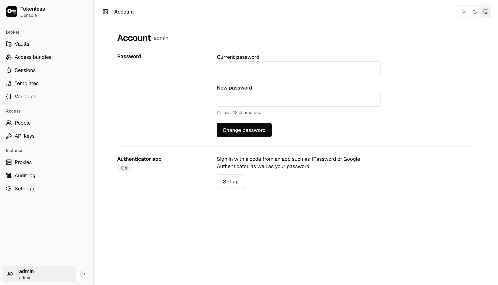

Click your name at the bottom of the sidebar for **Account**.

## Password

Enter your current password and a new one of at least 12 characters.
Changing it signs out your other sessions, in other browsers and the
CLI; this one stays signed in.

An admin who lost their password resets it on the server's host with
`tokenless admin reset-password`, which also ends that account's
sessions ([Accounts](../security.mdx#accounts)).

## Authenticator app

With an authenticator app (such as 1Password or Google Authenticator),
signing in needs a code from it as well as your password. It is
optional for everyone and recommended for admins.

1. **Set up** shows a key to enter in the app, with a copy button, and
   **Open in authenticator** to add it from a phone.
2. Enter a **code from the app** and **your password**, then **Turn
   on**.

To stop using it, **Remove** asks for a code and your password again.

## Confirming it is you

Sensitive actions ask everyone, admins included, to confirm it is them
within the last five minutes; signing in counts. With an authenticator
it asks for a code, without one for your password. That covers adding or
changing a service's secret, widening a service's hosts or a rule's MCP
tools, creating a launcher key, adding people to a vault or changing
their role, joining a vault, deleting a vault, and managing people, API
keys, templates, variables, proxies, single sign-on and audit export. A
dialog asks when it is due, and the action goes ahead once you answer.

## With single sign-on

If you sign in with [single sign-on](../settings.mdx#single-sign-on), the page
names the identity provider instead: your password, second factor and
groups are managed there, and your instance role and the vault roles your
groups give follow them at each sign-in. Sensitive actions send you back to the provider to sign in
again.
