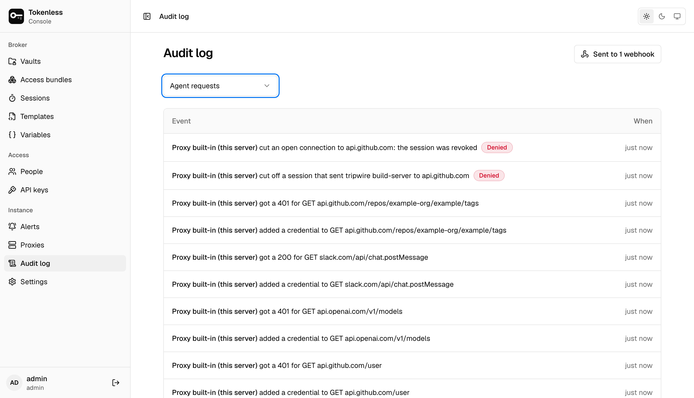
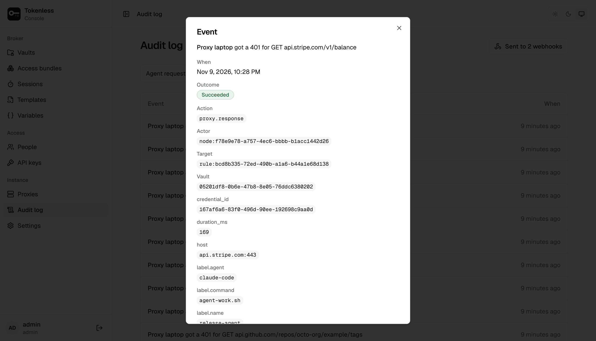

**Audit log** lists every event, newest first, each as one sentence:
who did what, and when. It records changes made in the console, the
API and the CLI (services, rules, bundles, sessions, people, API keys,
proxies, templates, variables and settings), sign-ins, and every
request agents make through a proxy.

An event that did not succeed carries a red **Denied** (refused, for
example by a role or a rule) or **Failed** (it was allowed, but did not
work) beside its sentence.

## Show one kind of event

The menu above the list narrows it to one kind of event:

| Show | Events |
|---|---|
| **All events** | Everything. |
| **Agent requests** | What proxies did with agents' traffic: credentials added, the API's answers, requests refused, connections passed through untouched or blocked. |
| **Sessions** | Sessions created, relabelled and revoked. |
| **Sign-ins** | Sign-ins to the console and the CLI (failed ones too), sign-outs, and codes entered for a sensitive action. |
| **Services** | Services added, tested and deleted, their secrets replaced, and their headers and placeholders changed. |
| **Rules**, **Bundles**, **Variables**, **Vaults** | Changes to each. |
| **People**, **API keys** | Invites, role changes, disabled accounts; keys created and revoked. |
| **Proxies**, **Templates**, **Settings** | Proxies enrolled and revoked, templates imported and approved, instance settings changed. |
| **Single sign-on** | Identity providers added, changed and deleted. |
| **Audit export** | Webhooks added, changed, paused, tested or skipped ahead. |
| **Alerts** | [Alerts](./alerts.mdx) raised from the proxies' reports, and who acknowledged them. |

## An event's details

Click an event for everything it recorded: the exact time, the outcome,
the action's name (such as `proxy.response`), the actor (a person, an
API key or a proxy) and target, the vault, and the event's own details.
For an agent request those include the host, the credential used, how
long it took and the session's labels, such as `agent=claude-code`.

The same requests appear, per session, on a
[session's page](./sessions.mdx#request-logs) and, per service, on a
[service's page](./vaults.mdx#a-services-page).

## Send it to your own system

The log lives in the control plane's database. To keep a copy in a SIEM
or log pipeline, an admin adds a webhook under
[Settings → Audit export](../settings.mdx#audit-export). The button at the top
of the page says how many webhooks the log is sent to (or **Send to a
webhook** when it goes nowhere), and the page warns while one is not
receiving events.

Everyone who can sign in can read the audit log, viewers included. An
API key reads only its own vault's events.
