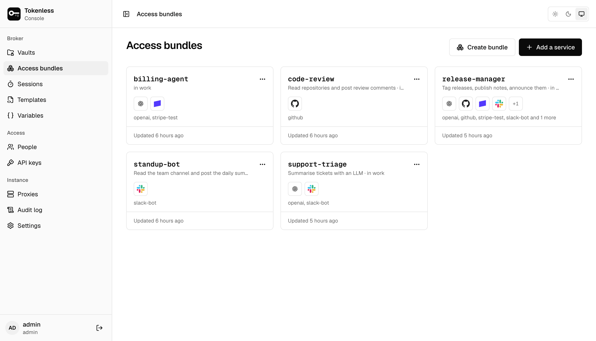
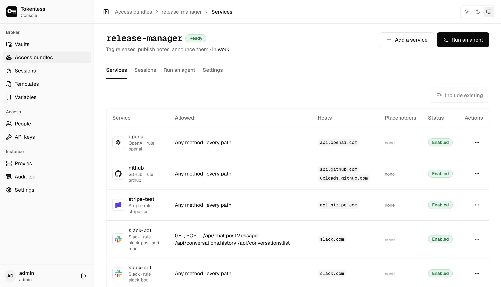
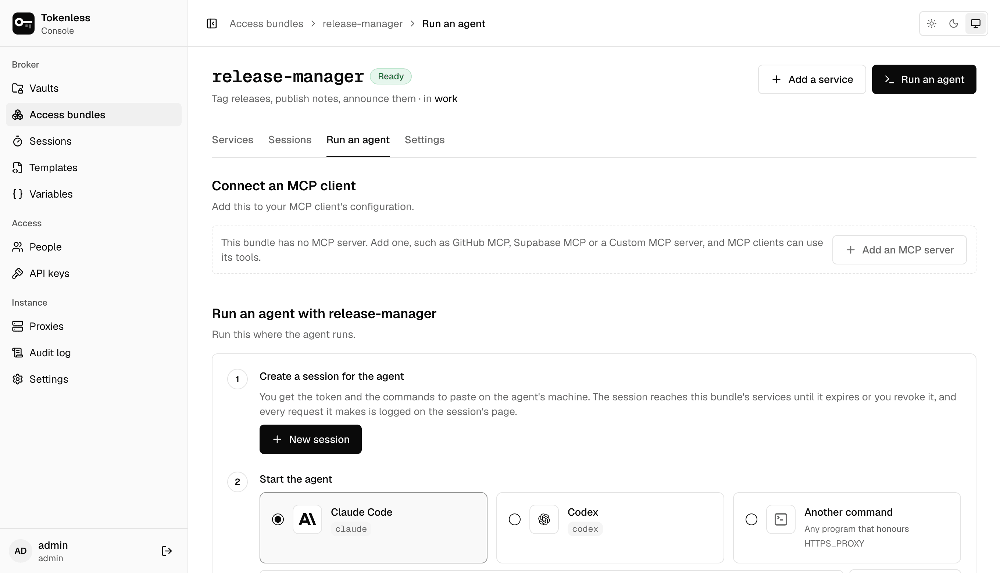

**Access bundles** shows each bundle with its vault, its services and
when it last changed. Its **⋯** menu copies the command that starts an
agent with it, or deletes it.

**Create bundle** asks for a vault, a name and an optional description,
and which of the vault's services to include. The name is what agents
start with on the command line: `tokenless run --bundle code-review`.
Names use letters, digits, `-`, `_` and `.`, up to 64 characters.

## A bundle's page

The badge beside the name says whether the bundle gives an agent
anything: **Ready**, **No services**, or **Every service disabled** when
all its rules are turned off.

### Services

The services in the bundle and the rule each uses.

- **Add a service** adds one from the catalogue: it is stored in the
  vault, given a rule and put in this bundle in one step.
- **Include existing** adds rules the vault already has.
- Each row shows what the rule allows (methods and paths), the hosts,
  any placeholders, and whether the rule is enabled. **⋯ › Remove**
  takes a service out of the bundle; the service and its rule stay in
  the vault.

Changes apply to sessions created afterwards. A running session keeps
what it started with; revoke it to cut it off now.

### Run an agent

Everything needed to start an agent with this bundle, in order.

1. **Create a session for the agent.** **New session** creates a
   session on this bundle and shows its token once. Copy it now.
2. **Start the agent.** Choose **Claude Code**, **Codex**, or **Another
   command** (any program that honours `HTTPS_PROXY`), and the proxy the
   agent's machine reaches. The page shows the commands to paste in the
   agent's terminal: installing tokenless on a first-time machine, and
   starting the agent behind the proxy.
3. **Teach the agent how the broker works** (optional). This installs
   the skill that tells the agent what it can reach, how to hand a tool
   a placeholder instead of a key, and how to read the proxy's 403, 407
   and 429 answers ([The agent skill](../agents.mdx#the-agent-skill)).

The same tab also shows:

- **Connect an MCP client**: an `mcpServers` block to add to a client's
  configuration, for bundles that include an MCP server.
- **A script that reads keys from its environment**: variables of the
  form `NAME=cb://<service>/<field>`, which `tokenless run` fills in
  ([Filling environment variables by reference](../placeholders.mdx#filling-environment-variables-by-reference)).
- **A session kept open for agents you start yourself**
  ([A session port](../agents.mdx#a-session-port-for-agents-you-start-yourself)).

### Sessions

The sessions created from this bundle, with **Revoke** on each live one.

### Settings

Rename the bundle or change its description, set a **request limit**,
copy its ID, see its history, or delete it. A request limit is the most
requests each session started from the bundle may make, launcher keys'
sessions included; whoever starts one may ask for fewer, never more.
Leave it empty for no limit. **Delete bundle** ends the live sessions started
from it (proxies refuse them at their next policy refresh), and agents
can no longer start with it. Its services and their rules stay in the
vault.

Editors and admins create and change bundles; viewers see them.
