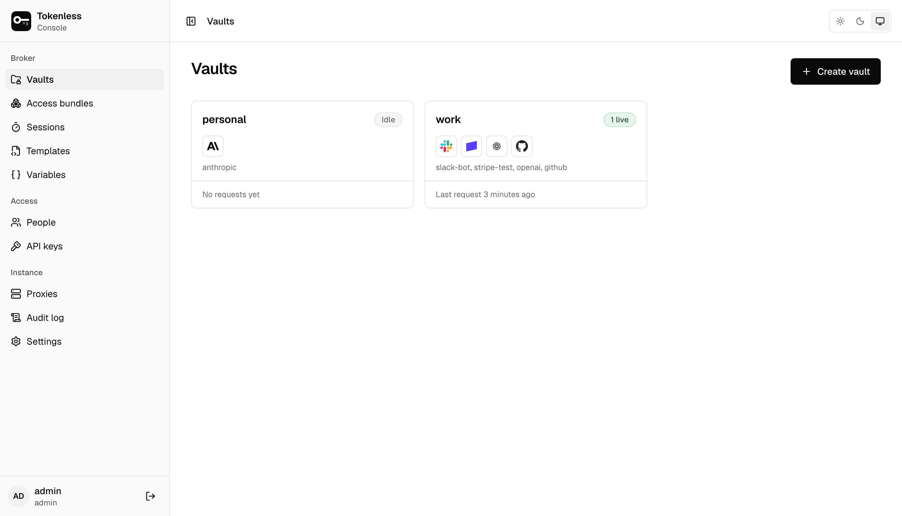

Open the address `tokenless serve` printed and sign in with the admin
account it created (see the [Quickstart](../quickstart.mdx)). The sidebar
groups everything into three parts.

| Part | Page | What it is for |
|---|---|---|
| Broker | [Vaults](./vaults.mdx) | The services (and their secrets) agents may use, and the rules that allow them |
| | [Access bundles](./bundles.mdx) | Named sets of services an agent starts with, such as `code-review` |
| | [Sessions](./sessions.mdx) | Every agent that has been given access, and each request it made |
| | [Templates](./templates.mdx) | The catalogue of services tokenless knows, and your own |
| | [Variables](./templates.mdx#variables) | Secrets stored once and used in any service as `{{NAME}}` |
| Access | [People](./people.mdx) | Who can sign in, and their role |
| | [API keys](./people.mdx#api-keys) | Keys for scripts and CI to use the console's API |
| Instance | [Alerts](./alerts.mdx) | Sessions cut off, refused again and again, or used through a second proxy |
| | [Proxies](./proxies.mdx) | The machines agents send their requests through |
| | [Audit log](./audit.mdx) | Everything that happened, who did it and whether it was allowed |
| | [Settings](../settings.mdx) | What agents may reach outside their services, single sign-on, audit export |

Your name at the bottom of the sidebar opens [your account](./account.mdx),
where you change your password and add an authenticator app.

## What you see depends on your role

What you can see and change depends on your
[roles](./people.mdx#roles): on the instance, and in each vault you are a
member of. You see only the vaults you are a member of, or, as an instance
admin, every vault. Where your role does not allow something, the page
says so instead of hiding it: "Only the vault's admins can do this",
"Starting sessions takes the runner, editor or admin role in the vault".

## Finding your way

- The breadcrumb at the top shows where you are (**Vaults › work ›
  github**) and takes you back up.
- Collapse the sidebar to icons with the button beside the breadcrumb,
  or with ⌘B (Ctrl+B on Linux and Windows).
- The three buttons at the top right choose a light or dark theme, or
  follow your system's.
- Every page has its own address, so you can bookmark it or send it to
  someone.

## A first session in five steps

1. [Add a service](./vaults.mdx#add-a-service): pick it from the
   catalogue and paste its key.
2. Put it in an [access bundle](./bundles.mdx), or create one as you
   add the service.
3. [Add a proxy](./proxies.mdx) if none is connected yet.
4. On the bundle's **Run an agent** tab, create a session and copy the
   commands to the agent's machine.
5. Watch its requests on the [session's page](./sessions.mdx#a-sessions-page).
