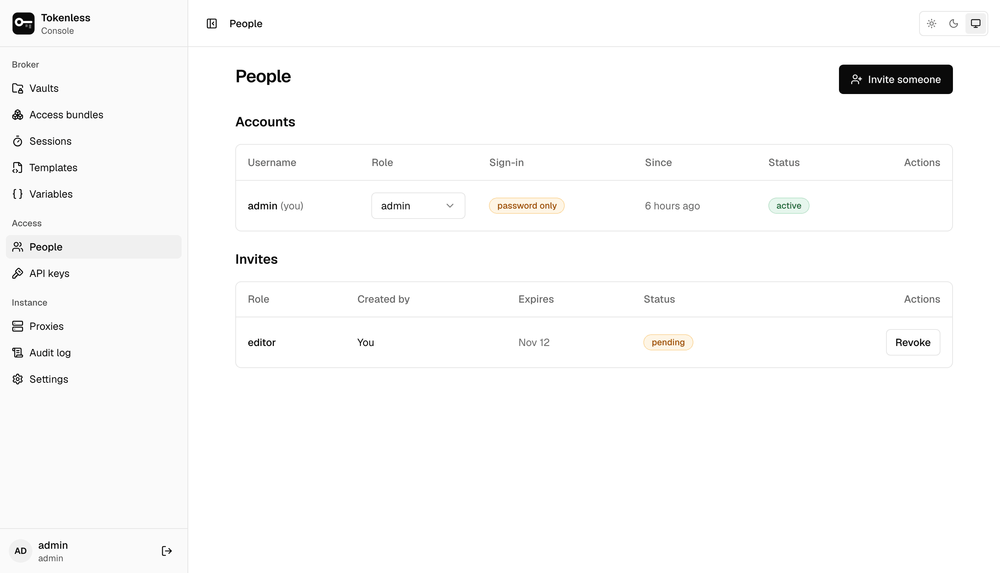
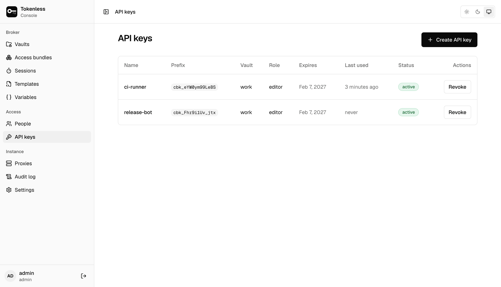

## People

**People** lists every account with its role, how it signs in, since
when, and whether it is active, then the invites still open.

### Invite someone

**Invite someone** asks for a role and how long the link works (at most
168 hours, 7 days), then shows an **invite link**. Send it to the
person: they choose their own username and password, and can add an
authenticator. The link works once. Anyone holding it can create the
account until it is accepted, revoked or expires, so send it privately.
**Revoke** on a pending invite stops the link at once.

With [single sign-on](/settings#single-sign-on), people need no invite:
their groups at the identity provider decide their role at every
sign-in, and the role column says so.

### Change a role, or disable someone

Change someone's role in the **Role** column; it applies at once.
**Disable** signs them out immediately and stops them signing in until
you **Enable** them again, with their existing password or single
sign-on. Only admins manage people.

## Roles

| Role | Can |
|---|---|
| **Admin** | Everything: vaults, services and their secrets, people, API keys, proxies, templates, variables and settings. Only people can be admins, never API keys. |
| **Editor** | Read every vault, its services (never their secrets), rules, sessions and the audit log. Also add, change and delete rules and access bundles, and create, relabel and revoke sessions. |
| **Viewer** | Read every vault, its services, rules, sessions and the audit log. Change nothing. |

A person's role applies to every vault. Adding a service or replacing a
secret, deleting a vault, and everything under **Instance** and
**Access** are for admins only.

With an authenticator app (or single sign-on), sensitive actions ask
for a code entered within the last five minutes, even for an admin:
adding or changing a service's secret, widening a service's hosts or a
rule's MCP tools, deleting a vault, and managing people, API keys,
templates, variables, proxies, single sign-on and audit export
([Accounts](/security#accounts)).

## API keys

**API keys** are for scripts and CI that call the console's API, for
example to mint a session for each job ([Automation and API keys](/automation)).
Agents get a session instead, from an access bundle's page.

**Create API key** asks for:

- **Name**, such as `ci-orchestrator`.
- **Vault**: a key is bound to exactly one vault and can do nothing
  outside it.
- **Role**: viewer (read the vault, the default) or editor (also manage
  rules, bundles and sessions). A key can never be an admin.
- **Expires in (days)**: between 1 and 365; 30 by default.

The key is shown **once**, after it is created; copy it then. The list
shows each key's prefix (the start of the key, enough to recognise it),
vault, role, expiry and when it was last used. **Revoke**
refuses anything using it immediately. Sessions it already created keep
running until they expire; revoke them on the
[Sessions](/console/sessions) page to end them now.

Only admins see and manage API keys.
