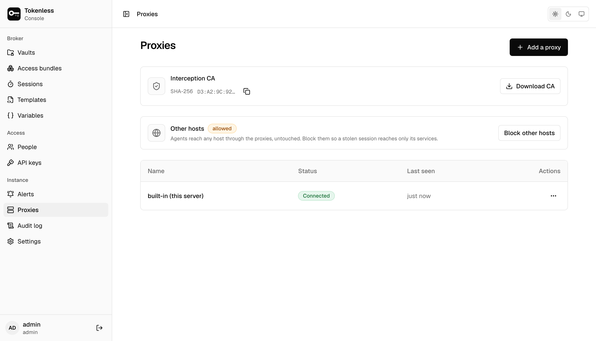
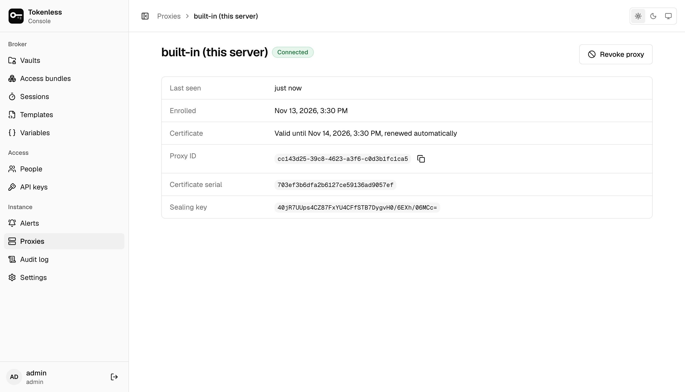

**Proxies** lists every proxy with its status and when it last checked
in. Agents reach services only through a connected proxy. `tokenless
serve` runs one for its own machine, listed as *built-in (this server)*;
add one for each other machine that runs agents.

## Add a proxy

**Add a proxy** shows two commands to run on the machine that will be
the proxy:

1. **Enrol the machine**: `tokenless node join`, with a one-time token.
   The token works once, expires in an hour and is not shown again.
   If the console's node API is not on port 8443 of this host, change
   the address in the command.
2. **Start the proxy**: `tokenless node run`.

It shows as **Connected** on this page within seconds. Running it as a
service, its listeners and how it shuts down are in
[Deploy to production](../deploy.mdx#proxies); from a terminal, an admin can
also mint the token with `tokenless proxy add`.

## The interception CA

To add a credential to an HTTPS request, the proxy has to read it, so
agents trust the instance's own certificate authority. The top of the
page shows its SHA-256 fingerprint (with a copy button) and **Download
CA** (`broker-ca.pem`). `tokenless run` installs the trust for the
command it starts; pass `--ca-fingerprint` to refuse a proxy that
presents a different CA ([Run an agent](../agents.mdx)).

## Status

| Status | Meaning |
|---|---|
| **Connected** | It checked in recently and is serving agents. |
| **Not heard from since …** | It stopped checking in. Agents routed to it fail; the others keep working. Once its policy lease lapses it refuses all traffic. |
| **Its certificate expired** | It could not renew its certificate in time and can no longer prove who it is to the control plane. Add it as a proxy again. |
| **No proxy is connected** | Shown at the top when none is: every agent request fails until a proxy checks in. |

## A proxy's page

Click a proxy for when it was last seen and enrolled, its certificate
(short-lived and renewed automatically), its ID, certificate serial and
sealing key: the public key credentials are encrypted to before they
leave the control plane, so only that proxy can read them.

**Revoke proxy** stops it receiving policy; it fails closed when its
lease lapses, within a minute by default. To use that machine again, add
it as a proxy again. **Show revoked** on the list brings revoked
proxies back into view. Only admins add and revoke proxies.
