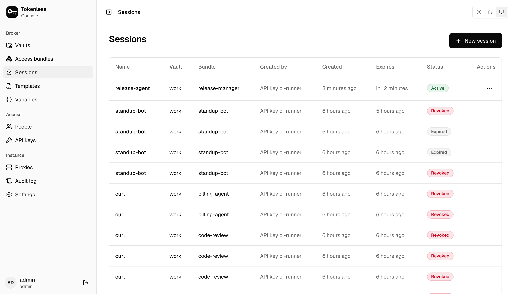
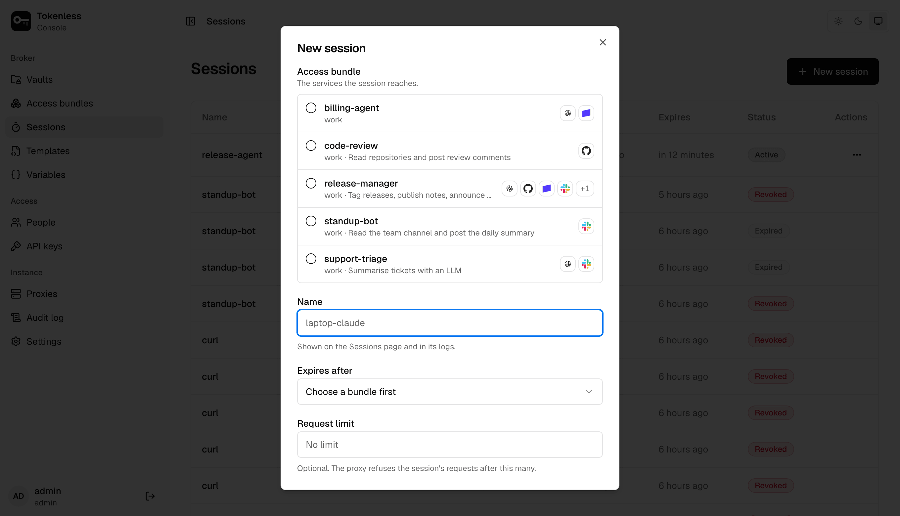
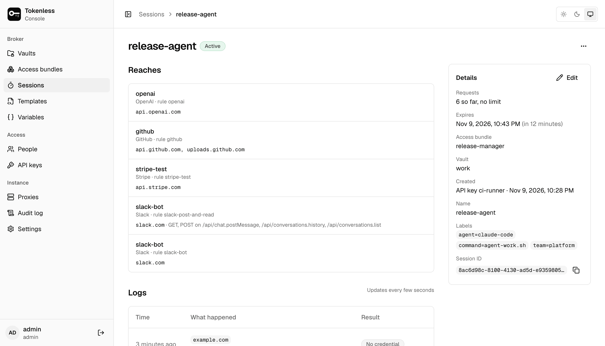
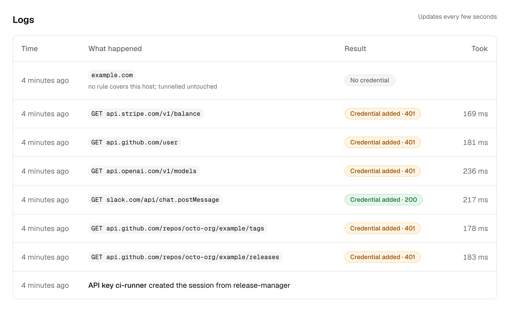

**Sessions** lists every session you can see, newest first: its name,
vault and bundle, who created it, when it expires, and whether it is
**Active**, **Expired** or **Revoked**.

Sessions started with `tokenless run` appear here on their own, named
after the command unless it was given `--name`. The rest are created in the console or over the API
([Automation and API keys](/automation)).

## Create a session

**New session** asks for:

- **Access bundle**: the services the session reaches. Each bundle shows
  its vault and the logos of its services.
- **Name**: shown on the Sessions page and in the logs, such as
  `laptop-claude`.
- **Expires after**: how long the token works: one day by default, and
  at most the instance's [session lifetime](/settings#session-lifetime).
- **Request limit** (optional): the proxy refuses the session's
  requests after this many.

**Create session** shows the token **once**, with the commands to start
an agent on another machine: Claude Code, an MCP client, or a CI job or
container (as environment variables to store as secrets). Copy what you
need before closing it; the token cannot be shown again. A vault's
**Sessions** tab can also mint a one-off session from individual rules
instead of a bundle, with audit labels of your own.

## A session's page

Click a session to see what it can reach and everything it did.

- **Reaches** lists each service the session can use, its rule and its
  hosts, with any method and path limits. A rule turned off since is
  marked **Rule turned off**.
- **Details** shows requests so far (and the limit, if any), when it
  expires, the bundle and vault it came from, who created it, its name,
  labels and ID. **Edit** changes the name and labels; requests keep the
  labels the session had when they were made.
- **⋯ › Revoke** ends the session. Proxies refuse it at their next
  policy refresh, so whoever holds the token loses access within
  seconds.

## Request logs

**Logs** lists every request the session made, newest first, a few
seconds after a proxy handles it. It updates on its own.

**Result** says what the proxy did:

| Result | Meaning |
|---|---|
| **Credential added · 200** | The proxy added the service's secret and sent the request on. The number is the API's answer: green for success, amber for anything else. A 401 here means the API refused the secret itself, for example an expired token. |
| **Blocked** | The proxy refused the request, so it never reached the API: for example the path, method or MCP tool is outside the rule, or the session reached its request limit. The agent got the proxy's answer explaining why ([When the proxy says no](/agents#when-the-proxy-says-no)). |
| **No credential** | No rule covers the host, so the proxy passed it through untouched, without reading it or adding a key ([Other hosts](/settings#other-hosts)). |
| **Failed** | The proxy added the credential, but the request failed, for example the API could not be reached. |

Click a request for everything recorded about it: the proxy that
handled it, the credential used, how long it took, the MCP tool called,
the placeholders it filled in, and the session's labels at the time.

The same log appears on a [service's page](/console/vaults#a-services-page),
for every session that used that service, and each request is also in
the [audit log](/console/audit).

Editors and admins create, change and revoke sessions; viewers can see
them and their logs.
