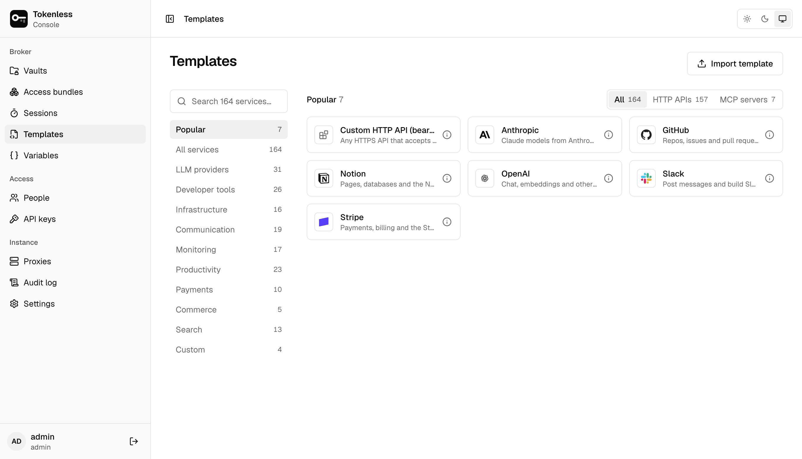
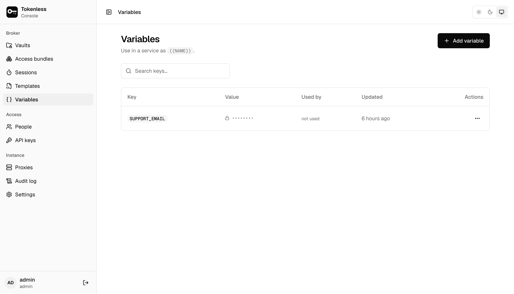

## Templates

**Templates** is the catalogue every service is created from: over 150
built in (HTTP APIs and MCP servers), grouped by category, with the most
used first. Search by name or by what the service does.



Click a template's **ⓘ** for its details:

- **Hosts**, **Paths** and **Methods**: the most any rule built from it
  may allow. A rule can narrow them, never widen them.
- **Injects**: how the proxy sends the secret, such as
  `Authorization: Bearer` or an `x-api-key` header.
- **Default headers**: headers new services start with, such as an API
  version. Each service can change them.
- **Variable**: the variable name suggested for its secret, such as
  `GITHUB_TOKEN`.
- **Test request**: what **Test** on a service's page sends.
- **Override**: whether a service may point it at other hosts, for a
  self-hosted instance. Only admins can; with an authenticator or single
  sign-on, it asks for a [recent code](./account.mdx#authenticator-app).

**Add to a vault** starts [adding a service](./vaults.mdx#add-a-service)
from it.

### Your own templates

For an API the catalogue does not have, either add a **Custom HTTP API**
or **Custom MCP server** service (you enter its hosts), or import a
template, so the service appears in the catalogue for everyone.

**Import template** takes YAML like this:

```yaml
id: inventory              # a-z, 0-9, - and _, up to 64
version: 1
name: "Inventory API"
description: "The internal inventory service."
category: custom
hosts:
  - inventory.example.com
allow:                     # the most a rule may allow
  paths: ["/api/*"]
  methods: ["GET", "POST"]
credential_fields:         # what someone pastes when adding the service
  - name: api_key
    label: "API key"
injection:                 # how the proxy sends it
  method: header
  name: "X-Api-Key"
  field: api_key
default_headers:
  - name: Accept
    value: "application/json"
validation:                # what Test sends; optional
  method: GET
  path: /api/health
  expect_status: [200]
```

`injection.method` is one of:

| Method | Sends | Fields |
|---|---|---|
| `bearer` | `Authorization: Bearer <field>` | `field` |
| `header` | `<name>: <prefix><field>` | `name`, `field`, optional `prefix` |
| `basic` | `Authorization: Basic` from a username and password | `username_field`, `password_field` |
| `basic_token` | `Authorization: Basic` with a fixed username, as Git hosts take a token | `username`, `password_field` |

Other keys: `kind: mcp` and `mcp_path` for an MCP server, `aliases`
(extra words search matches), `suggested_variable`, `popular`, and
`host_override` (`allowed`, `required`, `label`) to let a service set
its own hosts. A template is at most 64 KB. The built-in ones, in
`crates/tokenless-core/templates/` in the repository, are good examples.

An imported template stays **pending** until an admin approves the
hosts it binds credentials to: approving lets credentials created from
it be sent to those hosts. Only admins import and approve templates;
with an authenticator or single sign-on, both ask for a
[recent code](./account.mdx#authenticator-app).

## Variables

**Variables** stores a secret once, such as `GITHUB_TOKEN`, for any
service to use as `{{GITHUB_TOKEN}}` in a credential field or a custom
header. Replacing a variable updates every service that uses it.



- Keys use uppercase letters, digits and `_`, starting with a letter.
- A value is encrypted and can never be read back, only replaced. The
  old value cannot be recovered.
- A variable cannot be deleted while a service uses it; remove it from
  those services first.
- Only admins manage variables.

[Placeholders and variables](../placeholders.mdx) explains where variables and
placeholders fit when an agent needs a secret in a request body or an
environment variable.
