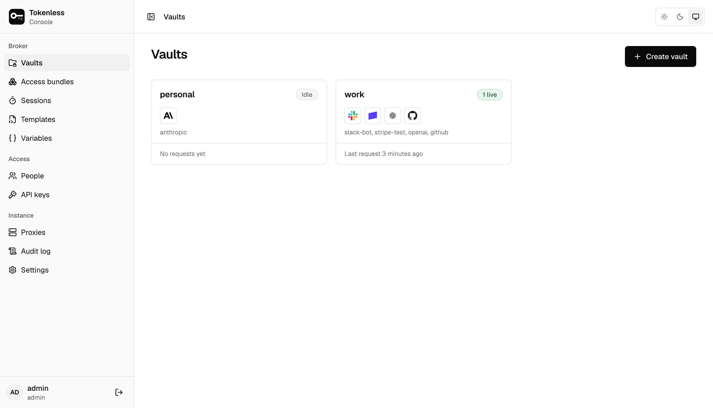
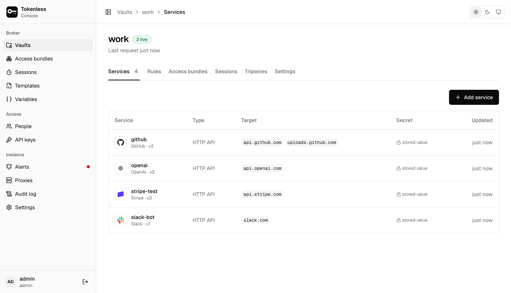
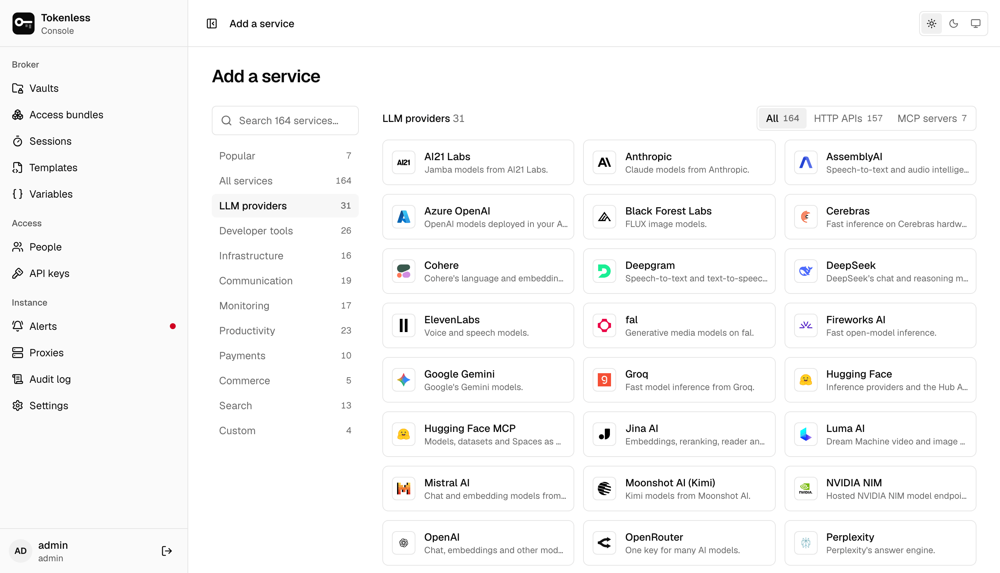
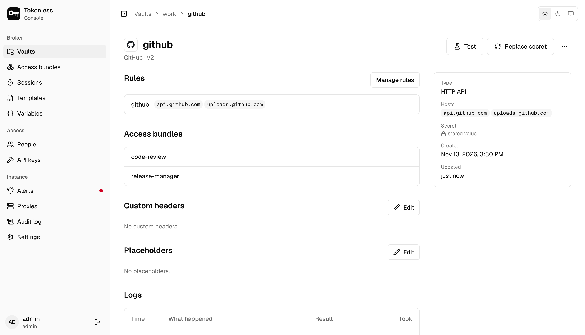
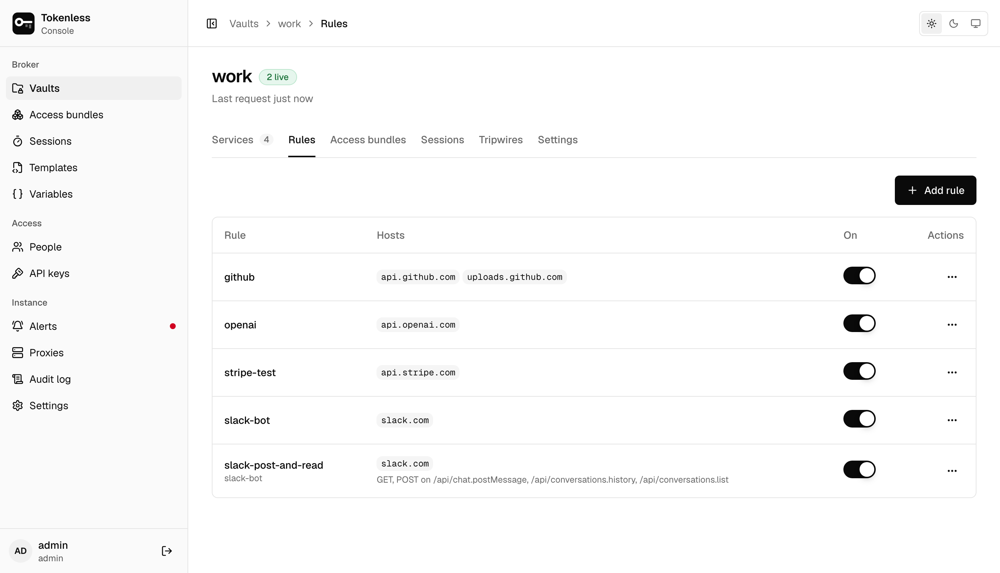

**Vaults** shows each vault with its services, whether an agent is
using it right now (**1 live**, or **Idle**) and when it last carried a
request. Admins create vaults here; adding a service can also create
one for you.

## A vault's tabs

Open a vault to see it in six tabs:

| Tab | What it holds |
|---|---|
| **Services** | Each service, its hosts and whether its secret works or has expired |
| **Rules** | What each service may be used for: hosts, paths, methods and MCP tools |
| **Access bundles** | The bundles built from this vault's rules |
| **Sessions** | The sessions minted in this vault; you can mint a one-off session here |
| **Tripwires** | Fake keys planted on agents' machines, and when each was last sent |
| **Settings** | The vault's ID, and deleting the vault |

## Add a service

**Add a service** (on **Vaults**, **Access bundles** or a vault)
opens the catalogue: over 150 built-in APIs and MCP servers, searchable
and grouped by category, plus a custom HTTP API or MCP server for
anything else.

Pick one, then fill in three things on one page:

1. **Credential**: the key or token, in the fields the service needs.
   It is encrypted on save and can never be read back, only replaced.
2. **Who can use it**: the vault (or a new one), and which access
   bundles get it (or a new bundle). Agents started with a checked
   bundle can use the service straight away.
3. **What will be created**: a summary to check before saving. The
   service is stored, given a rule that allows its hosts, and put in
   the bundles you checked, in one step.

When it is saved, **Run an agent with it** takes you to the bundle's
commands. Only admins add services. From a terminal, the same is
`tokenless service add` ([Set up from the terminal](../terminal.mdx)).

## A service's page

Click a service to see where it is used and what it did.

- **Test** sends the template's test request (for GitHub,
  `GET /user`) with the secret, and says whether the credential works.
  Templates without a test request say so. Only admins can test.
- **Replace secret** stores a new value, optionally with the date it
  stops working upstream; the proxy stops sending it then. Proxies use
  the new value at their next policy refresh, within seconds. The old
  value cannot be recovered.
- **Rules** and **Access bundles** show what uses the service. **Manage
  rules** opens the vault's Rules tab.
- **Custom headers** are sent with every request the credential is
  added to. Use a [variable](./templates.mdx#variables) as
  `{{NAME}}` to keep a header's value secret.
- **Placeholders** let an agent send a stand-in value that the proxy
  swaps for the secret on its way to this service's hosts, and nowhere
  else ([Placeholders and variables](../placeholders.mdx)).
- **Logs** lists the requests that used this service, a few seconds
  after a proxy handles them.
- **Delete service** (in the **⋯** menu) destroys the secret. Delete
  the rules that use it first.

## Rules

A rule lets sessions use one service. With no hosts, paths or methods
it allows everything the service's template allows; anything you enter
narrows that, never widens it.

**Add rule** asks for:

- **Name** and **Credential** (the service it uses).
- **Hosts**, one per line, for example `api.example.com`.
- **Paths**, one per line, with `*` as a wildcard: `/v1/*`.
- **Methods**, comma separated: `GET, POST`.
- **MCP tools**, for MCP servers: the tools a session may call, one
  per line. Leave it empty to allow every tool; otherwise a
  `tools/call` for any other tool is answered with an MCP error naming
  it, and never reaches the server. Allowing more tools is a sensitive
  action: with an authenticator or single sign-on, it asks for a
  [recent code](./account.mdx#authenticator-app).

The switch in the **On** column turns a rule off without deleting it:
sessions that include it stop getting its credential until it is
turned back on. **⋯ › Delete rule** deletes it: sessions that included
it can no longer use it. Editors and admins manage rules.

## Tripwires

A tripwire is a fake key that looks like a real one: an AWS access key,
a GitHub token, an OpenAI key or a generic API key. Plant it on an
agent's machine where real keys would be, somewhere the agent itself
never reads. An agent at work never sends it; someone who got onto the
machine and is collecting keys will. When a session sends it, the proxy
refuses the request, cuts the session off, and the control plane revokes
it everywhere and raises a [tripwire alert](./alerts.mdx).

**Plant a tripwire** asks where it goes (the machine's name, so the
alert says which one was entered) and what it looks like, then shows the
key **once**, ready to paste into `~/.aws/credentials`, a shell profile
or a `.env` file. The list shows each tripwire's first characters and
when it was last tripped. **⋯ › Delete tripwire** stops the proxies
looking for it; with an authenticator or single sign-on it asks for a
[recent code](./account.mdx#authenticator-app). Editors and admins
manage tripwires; a vault holds up to 20.

Every proxy looks for every vault's tripwires, in the URL and headers of
each request it opens to add a credential (Basic credentials included).
It does not read request bodies. When
[other hosts are blocked](../settings.mdx#other-hosts), it also opens
connections to the hosts a kind's key is used with (AWS's STS, IAM and
S3; GitHub) to look for it. When other hosts are allowed, they pass
through unread, so a key sent to a host no rule covers is not seen.

## Delete a vault

On the vault's **Settings** tab, **Delete vault** deletes its services
(and their secrets), rules, access bundles and tripwires, and revokes the API keys
bound to it. The audit trail is kept. It is refused while an agent is
using the vault unless you tick **End live sessions**. Only admins can
delete a vault; with an authenticator or single sign-on, it asks for a
[recent code](./account.mdx#authenticator-app) first.
