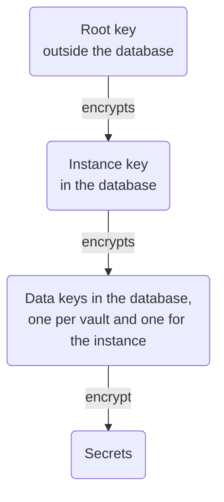

## Control plane

`serve` has two listeners:

| Listener | Flag | Default | Who connects |
|---|---|---|---|
| Console and management API | `--api-listen` | `127.0.0.1:8080` | People, API keys, `tokenless run` |
| Node API | `--node-listen` | `127.0.0.1:8443` | Proxies, with mutual TLS |

### HTTPS for the console

The session cookie is `Secure`, so browsers only sign in over HTTPS (or
on `localhost`). Either serve HTTPS directly:

```sh
tokenless serve --data-dir /var/lib/tokenless \
  --api-listen 0.0.0.0:443 \
  --api-tls-cert /etc/tokenless/fullchain.pem \
  --api-tls-key /etc/tokenless/privkey.pem
```

The certificate files are checked every minute and reloaded when they
change, so a renewal needs no restart. Or keep `--api-listen` on loopback
and put a TLS-terminating reverse proxy in front of it.

### The node API

Proxies authenticate to the node API with client certificates issued
when they enrol, so it must be reached directly (TCP), never through a
TLS-terminating proxy. Listen on an address your proxies can reach,
ideally a private network, and name it in the node API certificate:

```sh
tokenless serve ... \
  --node-listen 10.0.0.5:8443 \
  --node-api-name tokenless.internal --node-api-name 10.0.0.5
```

Proxies then join with `--control-url https://tokenless.internal:8443`.

### Validation requests to private services

**Test** on a service sends the template's validation request from the
control plane. For a self-hosted service with a private CA, pass
`--validation-ca ca.pem` (repeatable). If the service is on a private
address, also allow that range under
[Settings → Egress to private addresses](./settings.mdx#private-addresses).

## Proxies

On each machine that runs agents:

```sh
tokenless node join --control-url https://tokenless.internal:8443 \
  --token 'cbj1....' --name build-1 --state /var/lib/tokenless/node.json
tokenless node run --state /var/lib/tokenless/node.json
```

Get the join token from **Proxies → Add a proxy**. It works once and
expires in an hour. `node.json` (mode 0600) is the proxy's identity: keep
it, or the machine has to join again.

Keep the proxy listener (`--listen`, default `127.0.0.1:3128`) and the
MCP gateway (`--mcp-listen`, default `127.0.0.1:3129`) on loopback or a
private network. The proxy refuses traffic once its policy lease lapses
(`serve --lease-secs`, 60 seconds by default), so a proxy cut off from
the control plane fails closed.

For upstreams with a private CA, pass `--upstream-ca ca.pem` (repeatable).
`--no-public-roots` trusts only those.

On Ctrl-C or `SIGTERM` (what systemd and Docker send to stop it) the
proxy stops taking new connections and gives open tunnels `--drain-secs`
(30 by default) to finish before it cuts them. A second signal stops it at
once. It logs a warning if it had to cut traffic or could not ship audit
events. Keep the stop timeout above the drain time: systemd waits 90
seconds, Docker only 10, so give a proxy container
`stop_grace_period: 40s` or a shorter `--drain-secs`.

## systemd

```ini
# /etc/systemd/system/tokenless.service
[Unit]
Description=tokenless control plane
After=network-online.target
Wants=network-online.target

[Service]
User=tokenless
ExecStart=/usr/local/bin/tokenless serve --data-dir /var/lib/tokenless \
  --root-key-file ${CREDENTIALS_DIRECTORY}/root.key \
  --api-listen 127.0.0.1:8080 --node-listen 10.0.0.5:8443 \
  --node-api-name tokenless.internal
# The root key lives outside the data directory. LoadCredentialEncrypted=
# with a key from `systemd-creds encrypt` binds it to this machine's TPM.
LoadCredential=root.key:/etc/tokenless/root.key
StateDirectory=tokenless
Restart=on-failure
NoNewPrivileges=true
ProtectSystem=strict
ProtectHome=true
PrivateTmp=true

[Install]
WantedBy=multi-user.target
```

A proxy's unit is the same with
`ExecStart=/usr/local/bin/tokenless node run --state /var/lib/tokenless/node.json`.

## Docker Compose

[`examples/docker-compose`](https://github.com/gotempsh/tokenless/tree/main/examples/docker-compose)
runs the control plane with [Caddy](https://caddyserver.com) in front of
the console for HTTPS, so people and agents on other machines can reach
it. Caddy terminates TLS for the console and the management API on port
443; the node API stays on port 8443, published as it is, because proxies
authenticate to it with their own client certificates.

You need a name for the host with a publicly trusted certificate, which
the CLI and browsers both check:

- **A public DNS name** pointing at the host, with ports 80 and 443 open:
  Caddy gets the certificate from Let's Encrypt.
- **A Tailscale name** (`host.tailnet-name.ts.net`): uncomment the
  `tailscaled.sock` volume in `compose.yaml` and Caddy gets the certificate
  from Tailscale. Set `TOKENLESS_BIND` in `.env` to the host's tailnet IP
  (`tailscale ip -4`) so the ports listen only there; otherwise a host
  with a public address serves the console and the node API on it too.

Proxies also need port 8443 on that name. The ports listen on
`TOKENLESS_BIND`, every interface by default. Docker's published ports
bypass ufw and firewalld, so close them with that address or a firewall
in front of the host (a cloud security group), not with a host firewall.

On the server:

```sh
mkdir tokenless && cd tokenless
for f in compose.yaml Caddyfile .env.example; do
  curl -fsSLO "https://raw.githubusercontent.com/gotempsh/tokenless/main/examples/docker-compose/$f"
done
cp .env.example .env                     # set TOKENLESS_DOMAIN
chmod 700 .                              # only you can reach what is here
openssl rand -base64 32 > root.key       # the root key, outside the volume
chmod 444 root.key                       # readable by the image's user
docker compose up -d
docker compose logs tokenless            # the admin's password, printed once
```

Sign in at `https://<your domain>`, not at the `127.0.0.1` address the
log prints, which is the server's own view of itself. Back up the
`tokenless-data` volume and `root.key` separately ([Backups](#backups)).

On each machine that runs agents, [install](./install.mdx) tokenless,
then:

```sh
export TOKENLESS_URL=https://tokenless.example.com   # your domain
tokenless login                       # the admin, or anyone you invite
tokenless service add github --vault work --bundle code-review   # once, from any machine
tokenless proxy add --name laptop     # enrols with the node API on port 8443
tokenless node run                    # or as a service, see systemd above
tokenless run --vault work --bundle code-review -- claude
```

`TOKENLESS_URL` saves passing `--server` to each command. `service add`
asks for the key without showing it to the agent, and creates the vault
and the bundle the first time ([Set up from the terminal](./terminal.mdx)). To upgrade,
change `TOKENLESS_VERSION` in `.env`, then `docker compose pull && docker
compose up -d`; upgrade the control plane before the proxies
([Upgrades](#upgrades)).

## The root key

Every secret in the database is encrypted, and the keys that encrypt them
are themselves encrypted under one **root key** that the database never
contains:



A copy of the database or the data directory, without the root key,
decrypts nothing.

Create a key and keep it outside the data directory and its backups (a
secrets manager, a systemd credential, a Docker or Kubernetes secret):

```sh
openssl rand -base64 32 > /etc/tokenless/root.key
chmod 600 /etc/tokenless/root.key
tokenless serve --root-key-file /etc/tokenless/root.key ...
```

or pass it in the environment as `TOKENLESS_ROOT_KEY` (the base64 text).

Without either, `serve` creates `root.key` in the data directory on first
start, which is fine on your laptop, and warns at every start that a copy
of the directory then decrypts everything. To move it, stop the server,
move the file, and start with `--root-key-file`. A server started on data
whose key isn't there refuses to start; it never makes a new one.

Replace the key with:

```sh
tokenless admin rotate-root-key --root-key-file /etc/tokenless/root.key \
  --out /etc/tokenless/root-2.key --data-dir /var/lib/tokenless
```

It re-encrypts the instance key only, so it takes a moment however many
secrets there are. Restart with the new file, then destroy the old one.

Upgrading from a version with `master.key`: that file becomes the root
key, and the first start re-encrypts every stored secret under the new
keys in one transaction. Move `master.key` out as above.

## Backups

Back up the database and the root key **separately**: either alone is
useless, which is the point. The database runs in WAL mode; take a
consistent copy while it runs with:

```sh
sqlite3 /var/lib/tokenless/broker.db ".backup '/backups/broker.db'"
```

Losing the root key means losing every stored secret. You can't recover
them, by design.

## Upgrades

Replace the binary (or the image tag) and restart. Database migrations run
on start. The console is part of the binary, so it upgrades with it.
`tokenless update` replaces the binary with the latest release; see
[Install → Update](./install.mdx#update).
Upgrade the control plane before the proxies. A proxy older than the
control plane keeps working, but it does not use a service that needs a
newer proxy (for now, one whose secret has an expiry date, or a rule
with a Git scope) until it is upgraded; the control plane logs a warning naming that proxy.

### Automatic updates

On the control plane, a systemd timer can check for a release every day,
and update and restart only when there is one:

```ini
# /etc/systemd/system/tokenless-update.service
[Unit]
Description=Update tokenless to the latest release
After=network-online.target
Wants=network-online.target

[Service]
Type=oneshot
# --check exits 10 when a newer release exists, 0 when there is none.
# systemd expands $, so the shell's own are written $$.
ExecStart=/bin/sh -c '/usr/local/bin/tokenless update --check; s=$$?; \
  [ "$$s" -eq 10 ] || exit "$$s"; \
  /usr/local/bin/tokenless update && systemctl restart tokenless.service'
```

```ini
# /etc/systemd/system/tokenless-update.timer
[Timer]
OnCalendar=*-*-* 03:00
RandomizedDelaySec=30min
Persistent=true

[Install]
WantedBy=timers.target
```

```sh
systemctl enable --now tokenless-update.timer
```

It runs as root, which can replace `/usr/local/bin/tokenless`; the service
itself still runs as `tokenless`. A failed check or update fails the unit,
so `systemctl status tokenless-update` shows why.

Don't put proxies on the same timer: each host installs whatever release
is newest when its timer fires, so a release published between two runs
would reach the proxies before the control plane. Update a proxy once the
control plane runs the new version, to that version: `tokenless --version`
on the control plane names it, and `tokenless update --release v0.3.0`
installs it on the proxy. Then restart the proxy's service; it lets open
tunnels finish for `--drain-secs` first.

**Upgrading past the removal of `session_issuer` keys.** API keys with
the `session_issuer` role are deleted on upgrade, and whatever used one
gets `401 API key is unknown`. Give each agent a session instead: create
one on its access bundle's page, or with `tokenless session create`, and
pass the token in `TOKENLESS_SESSION_TOKEN`. A job that needs a fresh
session per run mints it with an `editor` key.

**Two services on one host.** When a session holds two rules for one host,
the proxy now uses the one whose path matches most specifically, and
refuses requests both match equally if their credentials differ (it used
to take whichever came first). New GitLab and Confluence services are
scoped so this never happens (`/api/*` and `/wiki/*`), but ones created
before allow every path: in a session with GitLab (Git), or with Jira on
the same site using another token, narrow their rule's paths to `/api/*`
or `/wiki/*`. The proxy's `403` names both rules.

## Logs and metrics

Logs are JSON lines on stdout. Set `RUST_LOG` to change the level, for
example `RUST_LOG=debug`. Proxies expose Prometheus metrics with
`node run --metrics-listen 127.0.0.1:9090`. Every change, injection and
refusal is also in the **Audit log**.

### OpenTelemetry

`serve` and `node run` also send their logs, and proxies their metrics, to
an OpenTelemetry Collector or any provider that accepts OTLP over HTTP.
Set the standard variables:

```sh
export OTEL_EXPORTER_OTLP_ENDPOINT=https://otlp.example.com:4318
export OTEL_EXPORTER_OTLP_HEADERS="authorization=Bearer <ingest token>"
export OTEL_RESOURCE_ATTRIBUTES="deployment.environment.name=production,team=platform"
tokenless node run
```

Nothing is sent until an endpoint is set. On start, the log says where
logs and metrics are going, or which setting it ignored and why.

| Variable | What it does |
|---|---|
| `OTEL_EXPORTER_OTLP_ENDPOINT` | Where to send, such as `http://localhost:4318`. Logs go to `/v1/logs`, metrics to `/v1/metrics`. |
| `OTEL_EXPORTER_OTLP_LOGS_ENDPOINT`, `OTEL_EXPORTER_OTLP_METRICS_ENDPOINT` | Send only that signal, or send it somewhere else. The full URL, path included. |
| `OTEL_EXPORTER_OTLP_HEADERS` | Headers for every export, such as an API key: `key=value,key2=value2`. Never logged. |
| `OTEL_RESOURCE_ATTRIBUTES` | Tags on everything sent: `key=value,key2=value2`, with `%2C` for a comma inside a value. |
| `OTEL_SERVICE_NAME` | The service name. By default `tokenless` for `serve` and `tokenless-proxy` for `node run`. |
| `OTEL_EXPORTER_OTLP_PROTOCOL` | `http/protobuf` (the default) or `http/json`. gRPC is not supported: use the collector's HTTP port, 4318. |
| `OTEL_EXPORTER_OTLP_CERTIFICATE` | A PEM file of CAs to trust for the collector's certificate, besides the public ones. |
| `OTEL_EXPORTER_OTLP_COMPRESSION` | `gzip` compresses exports. `zstd` is not built in. |
| `OTEL_EXPORTER_OTLP_TIMEOUT` | How long an export may take, in milliseconds (10000). `OTEL_EXPORTER_OTLP_LOGS_TIMEOUT` or `..._METRICS_TIMEOUT` sets it for one signal. |
| `OTEL_METRIC_EXPORT_INTERVAL` | How often proxies send their metrics, in milliseconds (60000). |
| `OTEL_LOGS_EXPORTER`, `OTEL_METRICS_EXPORTER` | `none` turns one signal off; `otlp` turns it on, to `http://localhost:4318` if no endpoint is set. |
| `OTEL_SDK_DISABLED` | `true` sends nothing. |

The signal-specific `_HEADERS`, `_PROTOCOL` and `_COMPRESSION` variables
and `OTEL_EXPORTER_OTLP_METRICS_TEMPORALITY_PREFERENCE` work as
their specification says.

Every log line `RUST_LOG` lets through is sent, with its fields as
attributes. A proxy's metrics are the Prometheus counters, named
`tokenless.proxy.<name>` without the `_total` (such as
`tokenless.proxy.requests_injected`), and tagged with the proxy's node ID
as `service.instance.id`. Telemetry waits in a bounded queue: a slow or
unreachable collector drops telemetry, and never slows the traffic. On
exit (Ctrl-C or `SIGTERM`), what is still queued is sent: logs wait at
most their timeout, metrics 5 seconds. Another stop signal, or the second
one that stops a proxy at once, exits without waiting. The exporter's own
debug messages, which include the full endpoint, are never logged, even
with `RUST_LOG=debug`. The first admin's password is printed to the terminal, not the
log, so it is never sent. An endpoint that is not a valid URL turns its
signal off, and the log names the variable without repeating its value.
