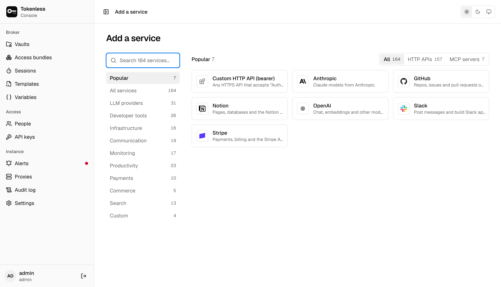
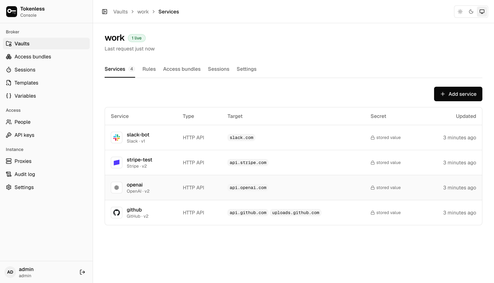
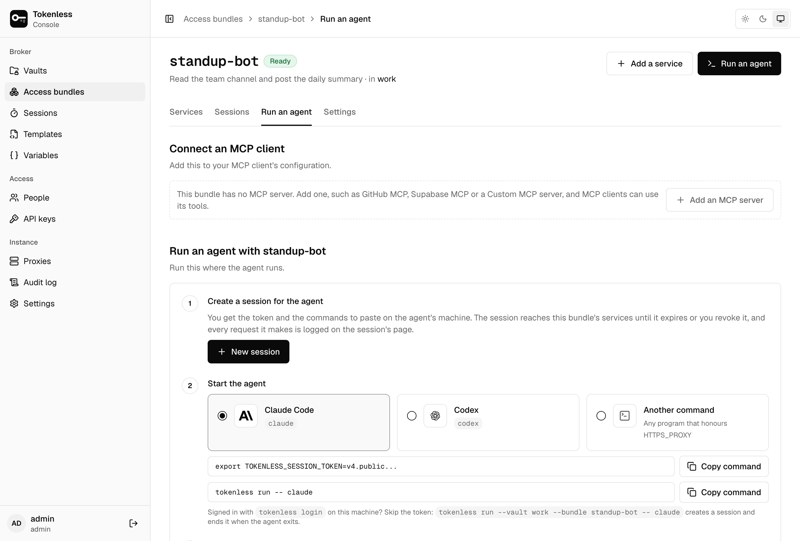
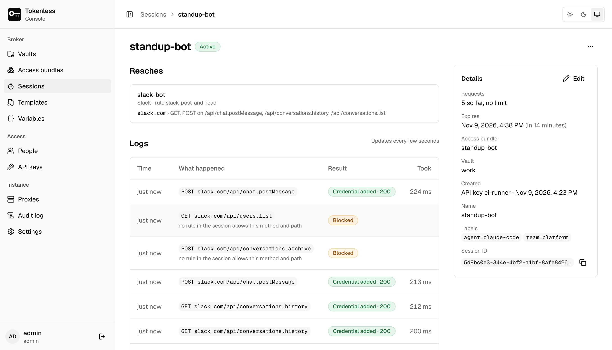
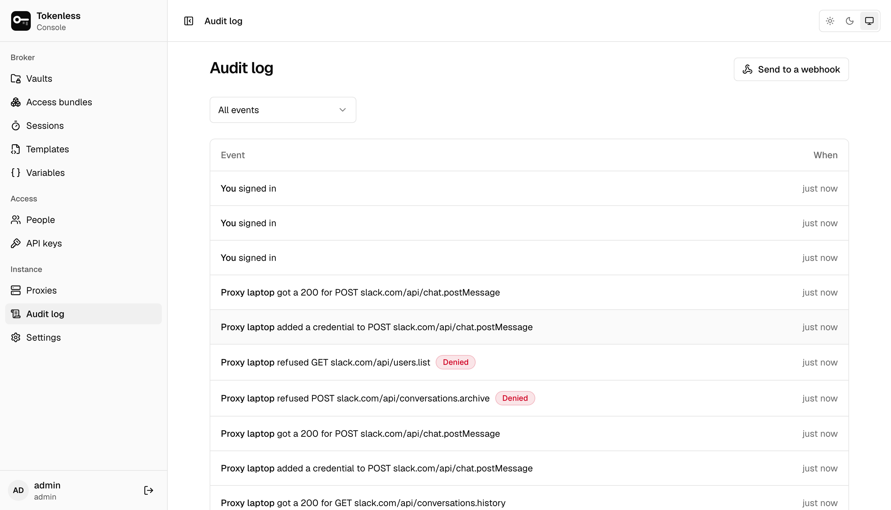

```sh
curl -fsSL https://raw.githubusercontent.com/gotempsh/tokenless/main/site/install.sh | sh
npx skills add gotempsh/tokenless     # the agent skill
```

Or let your coding agent set it up:

<CopyPrompt />

You store a credential once, for example a GitHub token. An agent then
sends its HTTPS traffic through a tokenless proxy with a short-lived
session. For the hosts its session allows, the proxy adds the real
credential to the request on the way out. The agent can call the API,
but it never holds the key, so it can't leak it, paste it into a log or
keep using it after the job.

```text
agent ──HTTPS_PROXY──▶ proxy ──adds Authorization──▶ api.github.com
                         ▲
                         │ signed policy, sealed credentials
                    control plane (console, API, vaults)
```

## Get started

<Cards>
  <Card title="Install" href="/install">
    One binary for Linux and macOS, with the web console built in.
  </Card>
  <Card title="Quickstart" href="/quickstart">
    The control plane, a proxy and an agent on one machine, in five steps.
  </Card>
  <Card title="Set up from the terminal" href="/terminal">
    Add services and start agents without opening the console.
  </Card>
  <Card title="Concepts" href="/concepts">
    Vaults, rules, access bundles and sessions, and how they fit.
  </Card>
</Cards>

## See it

<Steps>
<Step>

### Pick a service

Over 150 are built in, from LLM providers to payments, each knowing its
hosts and how to send the key. Anything else is a custom HTTP API or MCP
server.



</Step>
<Step>

### Paste the token, once

It is encrypted and write-only from then on. A vault lists each service
and the hosts it covers; nobody, admins included, sees the secret again.



</Step>
<Step>

### Run an agent

Group the services a job needs into an access bundle and copy the
commands that start the agent behind it (`tokenless run -- claude`). The
agent gets a local proxy address, never a token. MCP clients get a URL
instead.



</Step>
<Step>

### Watch what it does

Each session's page lists its requests as they happen: the credential
added and the API's answer, or why the proxy blocked a request outside
the bundle's rules.



</Step>
<Step>

### Keep the record

Every change, and every request the proxy adds a credential to or
refuses, is in the audit log, which can also be sent to a webhook.



</Step>
</Steps>

[Tour of the console](/console) goes through every page of the console.

## What you get

- **Secrets are write-only.** They are encrypted at rest with AES-256-GCM.
  Nobody can read one back, admins included. They only ever travel,
  sealed, to enrolled proxies.
- **Sessions are scoped and short-lived.** A session is bound to one vault,
  a set of rules, a lifetime and optionally a request limit. The ones
  `tokenless run` starts last 15 minutes and are renewed while the agent
  runs. Revoking one reaches the proxy within seconds.
- **Agents start with one command.** `tokenless run --bundle code-review -- claude`
  starts the agent behind a local proxy address with the right CA trusted
  and no token in its environment.
- **The proxy fails closed.** It runs from a signed, leased policy
  snapshot. When the lease lapses it refuses traffic, and it never injects
  a credential it can't audit.
- **No pivoting into your network.** By default the proxy won't connect to
  loopback, private, link-local or cloud metadata addresses.
- **Everything is audited**: every change, every injected request and
  every refusal.

## How it fits together

- **`tokenless serve`** runs the control plane: the web console, the
  management API, and the node API that proxies connect to. It stores
  everything in SQLite.
- **`tokenless node run`** runs a proxy, normally on the machine your
  agents run on.
- **`tokenless run`**, **`tokenless mcp`** and the other client commands
  start agents and MCP clients behind a proxy.

All three are the same binary.

## For agents

Every page is also plain Markdown: add `.md` to its address (this page's
is [`/index.md`](/index.md)), or use **Copy Markdown** at the top. [`/llms.txt`](/llms.txt) lists every page and
[`/llms-full.txt`](/llms-full.txt) holds them all in one file.
