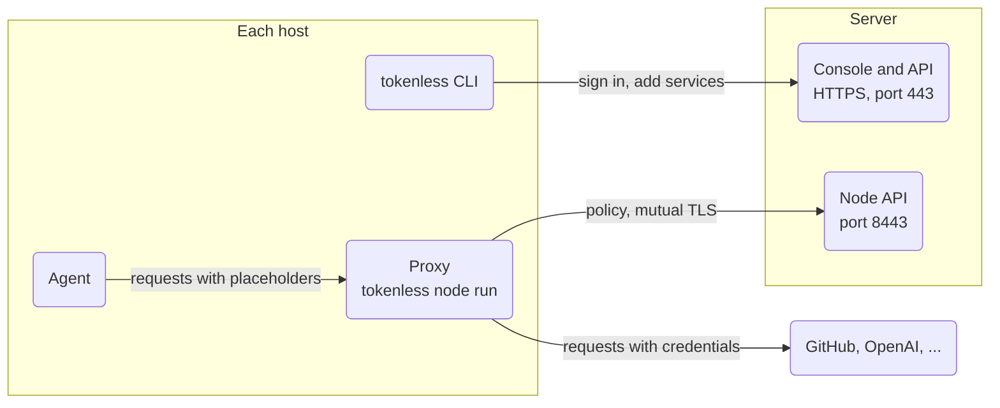

One server runs the control plane: the console, the vaults and their
secrets. Every other machine that runs agents (a laptop, a build box, a CI
runner) runs a **proxy** of its own, which fetches its policy from the
server and adds credentials to the agents' requests on the way out. The
secrets never leave the server and the proxies; the agents only ever see
placeholders.



| Where | Runs | Listens on |
|---|---|---|
| Server | `tokenless serve` (the control plane) | 443 for the console and the API, 8443 for proxies |
| Each host | `tokenless node run` (a proxy), then agents with `tokenless run` | loopback only: 3128 for the proxy, 3129 for the MCP gateway |

## Before you start

The server needs:

- **A name with a publicly trusted certificate**, because browsers and the
  CLI both check it. Either a DNS name pointing at the server with ports 80
  and 443 open (Let's Encrypt), or the server's Tailscale name
  (`server.tailnet-name.ts.net`), which needs nothing open to the internet
  if you keep the ports on the tailnet. This guide uses
  `tokenless.example.com`.
- **Port 443** reachable from the hosts, for the console and the API.
- **Port 8443** reachable from the hosts, for their proxies. Proxies
  authenticate there with client certificates, so it is never put behind a
  TLS-terminating proxy.

Proxies that lose the server for longer than their policy lease (60
seconds by default) stop forwarding requests: they fail closed. Put the
server where the hosts can always reach it.

## 1. Start the server

With Docker, use the Compose recipe: the control plane, and Caddy in front
of the console for HTTPS.

```sh
mkdir tokenless && cd tokenless
for f in compose.yaml Caddyfile .env.example; do
  curl -fsSLO "https://raw.githubusercontent.com/gotempsh/tokenless/main/examples/docker-compose/$f"
done
cp .env.example .env               # set TOKENLESS_DOMAIN=tokenless.example.com
openssl rand -base64 32 > root.key   # the root key, outside the data volume
docker run --rm -v "$PWD/root.key:/key" busybox:1.37 \
  sh -c 'chown 65532:65532 /key && chmod 400 /key'   # the image's user
docker compose up -d
docker compose logs tokenless      # the admin's password, printed once
```

The key now belongs to the image's user, so the server reads it without
any warning; copying it for a backup needs `sudo` (or the same
`docker run`).

On a tailnet, also set `TOKENLESS_BIND` in `.env` to the server's tailnet
IP (`tailscale ip -4`) and uncomment the `tailscaled.sock` volume in
`compose.yaml`. Docker's published ports bypass ufw and firewalld, so
`TOKENLESS_BIND` or a firewall in front of the server (a cloud security
group) is what keeps them off a public address. At boot, Docker can start
the containers before Tailscale has given the server that address, and a
container whose port can't bind isn't restarted, so let it bind the
address before it exists:

```sh
echo 'net.ipv4.ip_nonlocal_bind = 1' | sudo tee /etc/sysctl.d/90-tokenless.conf
sudo sysctl --system
```

More on the recipe, backups and upgrades:
[Deploy → Docker Compose](./deploy.mdx#docker-compose).

Without Docker, [install the binary](./install.mdx) and use the unit in
[Deploy → systemd](./deploy.mdx#systemd), with your certificate on port
443. `--no-proxy` keeps `serve` from running its own proxy: here the
proxies run on the hosts. In its `[Service]` section:

```ini
ExecStart=/usr/local/bin/tokenless serve --data-dir /var/lib/tokenless \
  --root-key-file ${CREDENTIALS_DIRECTORY}/root.key \
  --api-listen 0.0.0.0:443 \
  --api-tls-cert /etc/tokenless/fullchain.pem \
  --api-tls-key /etc/tokenless/privkey.pem \
  --node-listen 0.0.0.0:8443 \
  --node-api-name tokenless.example.com \
  --no-proxy
# The unit runs as the tokenless user: let it bind 443, and nothing else.
AmbientCapabilities=CAP_NET_BIND_SERVICE
```

That user also has to read the certificate's key, and Let's Encrypt keeps
`privkey.pem` readable by root only. A certbot deploy hook copies both
files for it after every renewal, and the server picks up the new ones
within a minute, without a restart. Certbot runs it after any certificate
it renews, so it skips the others on the same machine:

```sh
#!/bin/sh
# /etc/letsencrypt/renewal-hooks/deploy/tokenless (chmod +x)
[ "$RENEWED_LINEAGE" = /etc/letsencrypt/live/tokenless.example.com ] || exit 0
install -o tokenless -m 0644 "$RENEWED_LINEAGE/fullchain.pem" /etc/tokenless/fullchain.pem
install -o tokenless -m 0600 "$RENEWED_LINEAGE/privkey.pem" /etc/tokenless/privkey.pem
```

Run it once yourself for the first certificate:
`sudo RENEWED_LINEAGE=/etc/letsencrypt/live/tokenless.example.com /etc/letsencrypt/renewal-hooks/deploy/tokenless`.

`--node-api-name` must be the name the hosts use: their proxies check the
node API's certificate against it.

Sign in at `https://tokenless.example.com` as `admin` with the printed
password, and change it under **Account**.

## 2. Invite people

Under **People → Invite someone**, pick a role and send the invite link
([People](./console/people.mdx)). Each person signs in with their own
account; nobody shares the admin. With
[single sign-on](./settings.mdx#single-sign-on) people need no invite.

## 3. Add services

Add each service once, from the console or from any host. The CLI asks for
the key without the agent ever seeing it:

```sh
export TOKENLESS_URL=https://tokenless.example.com
tokenless login --username <you>   # without --username, it signs in as admin
tokenless service add github --vault work --bundle code-review
```

The first `service add` for a vault creates the vault and the bundle. A
**bundle** is what an agent gets: a set of services and rules. More in
[Set up from the terminal](./terminal.mdx).

## 4. Connect a host

On each machine that runs agents, [install tokenless](./install.mdx), then
point it at the server once for the shell:

```sh
export TOKENLESS_URL=https://tokenless.example.com
tokenless login --username <you>
```

Add `TOKENLESS_URL` to your shell profile so every command uses the server
without `--server`. `login` takes a password, so an account that only
uses single sign-on skips it: add services in the console, and start
agents with a session token from the bundle's page, as for
[CI runners](#hosts-without-a-person-ci-runners).

### Enrol the host's proxy

An admin enrols it in one step:

```sh
tokenless proxy add --name laptop --state ~/.tokenless/node.json
```

Everyone else asks an admin for a join token: **Proxies → Add a proxy** in
the console shows it, with the command to run on the host. It works once
and expires in an hour:

```sh
tokenless node join --control-url https://tokenless.example.com:8443 \
  --token 'cbj1....' --name laptop --state ~/.tokenless/node.json
```

`node.json` (mode 0600) is the host's identity. Keep it: without it the
host has to enrol again. The host shows on the **Proxies** page.

### Keep the proxy running

Try it in a terminal first:

```sh
tokenless node run --state ~/.tokenless/node.json
```

It shows as **Connected** on the Proxies page within seconds. Then run it
as a service so it starts with the machine.

Both services below name the binary by its full path: use what
`command -v tokenless` prints (the install script puts it in
`/usr/local/bin`, or `~/.local/bin` when that is not writable).

On Linux, with systemd, as your user:

```ini
# ~/.config/systemd/user/tokenless-proxy.service
[Unit]
Description=tokenless proxy

[Service]
ExecStart=/usr/local/bin/tokenless node run --state %h/.tokenless/node.json
Restart=on-failure

[Install]
WantedBy=default.target
```

```sh
systemctl --user enable --now tokenless-proxy
loginctl enable-linger "$USER"     # keep it running when you are logged out
```

On macOS, with launchd, in `~/Library/LaunchAgents/dev.tokenless.proxy.plist`
(replace `you` with your username; launchd needs full paths):

```xml
<?xml version="1.0" encoding="UTF-8"?>
<!DOCTYPE plist PUBLIC "-//Apple//DTD PLIST 1.0//EN" "http://www.apple.com/DTDs/PropertyList-1.0.dtd">
<plist version="1.0">
<dict>
  <key>Label</key><string>dev.tokenless.proxy</string>
  <key>ProgramArguments</key>
  <array>
    <string>/usr/local/bin/tokenless</string>
    <string>node</string><string>run</string>
    <string>--state</string><string>/Users/you/.tokenless/node.json</string>
  </array>
  <key>RunAtLoad</key><true/>
  <key>KeepAlive</key><true/>
  <key>StandardErrorPath</key><string>/Users/you/Library/Logs/tokenless-proxy.log</string>
  <key>StandardOutPath</key><string>/Users/you/Library/Logs/tokenless-proxy.log</string>
</dict>
</plist>
```

```sh
launchctl bootstrap "gui/$(id -u)" ~/Library/LaunchAgents/dev.tokenless.proxy.plist
```

The proxy listens on loopback only, so only this host's agents use it. A
proxy for several machines on a private network is possible (`--listen` on
a private address, `tokenless run --proxy` on the others), but one proxy
per host keeps each host's traffic its own.

### Run an agent

```sh
tokenless status                                     # what is set up, and what is next
tokenless run --vault work --bundle code-review -- claude
```

`tokenless run` checks that the proxy answers, mints a session for the
bundle, trusts the proxy's certificate authority for the command it starts,
and ends the session when the agent exits. Install the
[agent skill](./agents.mdx) so the agent knows how to use placeholders.

## Hosts without a person: CI runners

A runner has no one to type a password. Create a session on the bundle's
page in the console, store its token as the CI secret
`TOKENLESS_SESSION_TOKEN`, enrol the runner's proxy with a join token as
above, and start the job with:

```sh
tokenless run --server https://tokenless.example.com -- ./scripts/release.sh
```

Revoking the session cuts the job off. Other options, such as an API key
that mints a fresh session per job, are in
[Automation → In CI](./automation.mdx#in-ci).

## When something is wrong

| What you see | Why, and what to do |
|---|---|
| Signing in to the console doesn't stick | The page is on plain HTTP, and the session cookie only works over HTTPS: use the `https://` name, not an IP or port 8080. |
| `node join` or `node run`: certificate not valid for the name | The server's `--node-api-name` (`TOKENLESS_DOMAIN` in the recipe) is not the name the host dials. Restart the server with that name added. |
| `node join`: connection refused or a timeout | Port 8443 is closed between the host and the server, or `TOKENLESS_BIND` is an address the host can't reach. |
| `tokenless run`: no proxy is answering | Start `tokenless node run` on this host (the service above), or point `--proxy` at the one to use. |
| The agent's requests fail with `x-broker-error: 1` | The proxy refused them: read the response body, which says why ([When the proxy says no](./agents.mdx#when-the-proxy-says-no)). |
| The proxy stops forwarding after the server was unreachable | It failed closed when its lease lapsed. It resumes on its own once it reaches the server again. |

Upgrade the server before the hosts: an older proxy keeps working with a
newer server ([Upgrades](./deploy.mdx#upgrades)).
