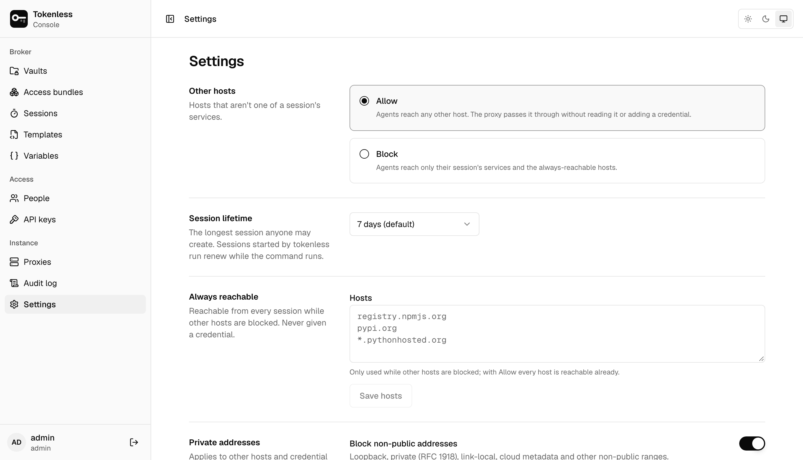
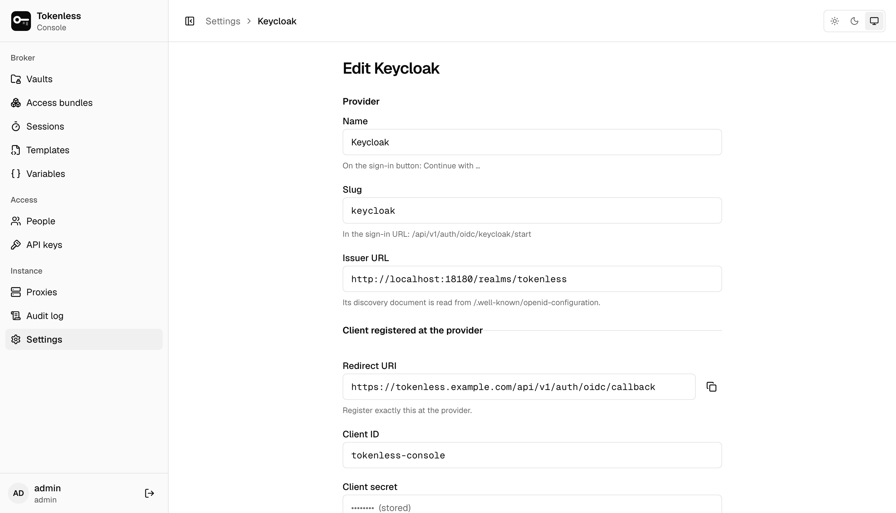
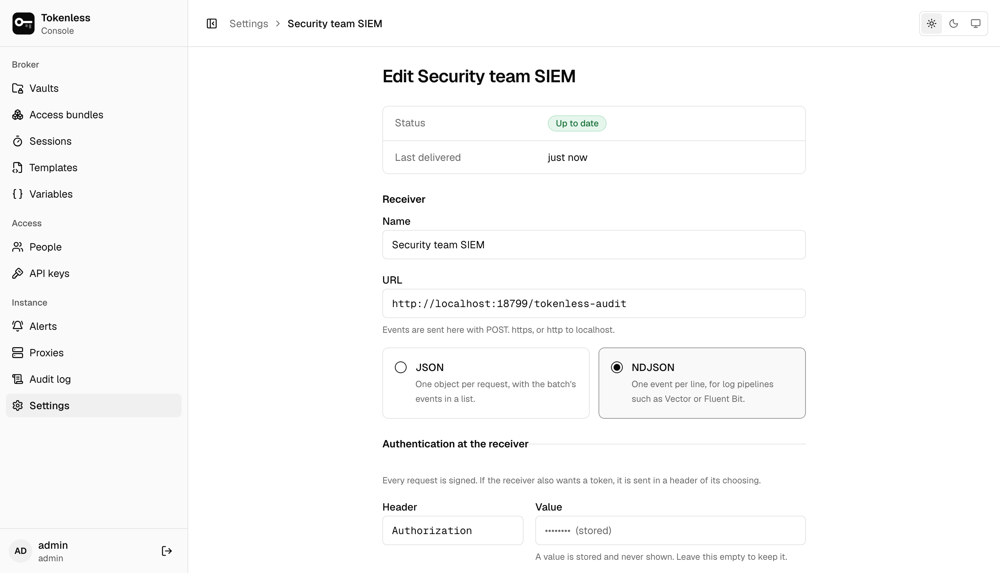

## Other hosts

Agents send all their HTTPS traffic through the proxy. This decides what
happens to hosts that aren't one of their services:

- **Allow** (the default): the connection is passed through untouched.
  The proxy doesn't decrypt it or add any credential.
- **Block**: agents reach only the services in their session, plus the
  [always reachable](#always-reachable) hosts.

## Session lifetime

The longest session anyone may create, from 15 minutes up to 90 days;
7 days by default (an instance created before this default keeps the
1 hour it had). Sessions you hand an agent last at most this long; ones
`tokenless run --bundle` mints are renewed while the agent runs, so they
can stay short. A short lifetime limits how long a leaked session token
is useful.

## Always reachable

Hosts every session may reach even when other hosts are blocked, such as
package registries and documentation, one per line:
`registry.npmjs.org`, `*.pythonhosted.org` (one label), with `:port` for
ports other than 443. They are passed through untouched and never given a
credential.

## Private addresses

By default the proxy won't connect to loopback, private, link-local or
cloud metadata addresses, so an agent can't use it to reach your internal
network. Allow specific ranges here when a service you broker lives on
one. This applies to other hosts and to credential tests; a session's own
services are always reachable.

## Cut off probing sessions

An agent at work is refused now and then. A session refused again and
again, host after host or path after path, is more likely someone on the
agent's machine trying what else the proxy will do. By default, after
**20 refusals in 5 minutes** the proxy stops serving the session at once,
even for what its rules allow, and reports it; the control plane then
revokes it, so every proxy stops. The agent gets `407` saying the session
was cut off.

The session's page shows the refusals that did it and the revocation, as
`proxy.quarantine` and `session.revoke` with reason `quarantine` in the
audit log. A cut-off session is never resumed: once you have looked at
what it tried, start a new one. Choose a stricter or looser threshold
here, or turn it off; loosening it asks you to confirm it's you. Over the
API it is `quarantine` (`{"refusals": 20, "window_secs": 300}`, or
`null`) in `PUT /api/v1/settings`. A proxy older than this release keeps
running without it.

## Single sign-on

People can sign in with an OpenID Connect identity provider that sends
group membership (Okta, Microsoft Entra ID, Keycloak, Authentik and
others) instead of a password. Add one under **Settings → Single sign-on → Add a
provider**:

1. At the provider, register a web application with the **Redirect URI**
   the form shows: this instance's address followed by
   `/api/v1/auth/oidc/callback`. The address must be the one people's
   browsers use.
2. Enter the provider's **issuer URL** (its discovery document is read
   from `/.well-known/openid-configuration`), the **client ID** and,
   for a confidential client, the **client secret**. The secret is
   encrypted at rest and never shown again; leave the field empty when
   editing to keep it. Saving reads the discovery document, so the
   issuer must be reachable from the server when you save.
3. Map the provider's **groups** to roles. Someone in several mapped
   groups gets the highest role; someone in none is refused, and the
   message names the groups the provider sent so you can fix the mapping.
   Groups are read from the `groups` claim of the ID token, or of the
   user info when the token leaves it out; set another claim, or a dotted
   path such as `realm_access.roles`, for providers that put them
   elsewhere. Some providers send groups only for an extra scope.



The sign-in page then shows **Continue with *name***. The first sign-in
creates the account, named by the `preferred_username` claim unless you
choose another; a local account that already has the name is never taken
over, and the sign-in is refused instead. The role follows the person's
groups at every sign-in and cannot be changed by hand. Disabling the
account under **People** still locks them out.

People who sign in with a provider have no password or authenticator
here. When a sensitive action needs a fresh confirmation, they sign in at
the provider again in a popup window. Turning a provider off hides its
button and ends the sessions of everyone who signed in with it; a
provider people have signed in with can't be deleted, only turned off.

The browser is sent to the provider with PKCE and a nonce. The answer is
accepted only in the browser that asked, within 10 minutes: the sign-in
travels in a sealed cookie, so starting one stores nothing on the server. ID
tokens must be signed (RS, PS, ES or EdDSA; never `none` or a shared
secret) by a key in the provider's published key set, and are checked for
issuer, audience, expiry and nonce.

## Password sign-in

With a provider that is on, you can limit passwords to **local admins
only**. Everyone else then signs in with single sign-on, and the existing
sessions of local non-admin accounts stop working. Local admins keep their
password (and authenticator) to get in when the provider is down: the
sign-in page offers **Sign in with a local admin account** under the
provider buttons. Invites can then only create admins. The last provider
that is on can't be turned off or deleted while this is set.

## Idle sign-ins

A browser or CLI login that goes unused this long is signed out, before
its 12-hour limit: a forgotten console tab or a `tokenless login` on a
machine you no longer use stops working on its own. The default is
2 hours; pick between 15 minutes and 7 days, or **Never**. Changing it
applies to existing sign-ins at once. Over the API it is
`idle_timeout_secs` (`null` for never, otherwise 300 to 2,592,000) in
`PUT /api/v1/auth/sign-in-settings`.

## Audit export

The audit log lives in the control plane's database. To keep a copy in
your own system (a SIEM, a log pipeline, any HTTPS endpoint), add a
webhook under **Settings → Audit export → Add a webhook**, or follow
**Send to a webhook** on the **Audit log** page. Every audit event is then
sent to it as it is written, in order, in signed batches, and retried
until it arrives. An instance sends to at most 10 webhooks.

- **URL.** `https`, or `http` only to localhost. Put a receiver's token in
  the **auth header** (for example `Authorization: Bearer …`), not in the
  URL: the header's value is encrypted at rest and never shown again. The
  audit log, the server log and the delivery errors shown here record only
  the URL's scheme and host, since anyone who can read the audit log
  (viewers too) would see the rest. Requests follow no
  redirects and give up after 10 seconds.
- **Format.** *JSON* sends one object per request,
  `{"type":"tokenless.audit","version":1,"batch_id":"…","events":[…]}`.
  *NDJSON* (`application/x-ndjson`) sends one event per line, for
  pipelines such as Vector or Fluent Bit. Each event is the audit event as
  the API returns it, plus `seq`, its position in this instance's audit
  log. A batch holds at most 500 events and 1 MiB.
- **Which events.** Filter by action (a prefix: `credential.` sends every
  credential change), by outcome, and by vault. An empty filter sends
  everything. Events the filter leaves out are passed over, not held back.
- **Start from.** A new webhook gets events written from now on, or the
  whole audit log this instance holds, oldest first.



Delivery is at least once. Any 2xx answer counts as delivered; anything
else, or no answer, is retried from the same batch after 1 second,
doubling to at most 5 minutes, so a receiver that was down for an hour
gets the hour's events in order when it comes back. A batch that is
retried is the same batch under the same `webhook-id`, even when newer
events were written meanwhile and across a restart, so a receiver that
may see one twice can drop repeats by it. Pausing, renaming or a new
signing secret keep the ID; changing the filter during a retry makes the
next attempt a new batch with a new ID, since another filter selects other
events. Each event's `seq` deduplicates in every case. Each webhook shows its status: **Up to date**,
**Sending** (with how many events it is behind), **Retrying**, **Failing**
(after 15 minutes of retries) or **Paused**, with the receiver's last
error. The **Audit log** page and the sidebar warn while one is failing.

From a webhook's menu you can **send a test** (one sample event, which is
not added to the audit log), **pause** it (nothing is lost: it resumes
from where it stopped), **skip to now** (the events not yet sent stay in
the audit log but are never sent to it; the skip itself is audited), make
a **new signing secret**, or delete it. Managing webhooks is for admins
and needs a fresh confirmation, like other sensitive actions; every
change is in the audit log.

### Verifying a request

Requests are signed as in the
[Standard Webhooks](https://www.standardwebhooks.com) specification, so
its libraries verify them. The signing secret (`whsec_…`) is shown once,
when the webhook is added or given a new secret. Each request carries:

| Header | Value |
|---|---|
| `webhook-id` | The batch's ID, the same on every retry of it |
| `webhook-timestamp` | Seconds since the Unix epoch when it was sent |
| `webhook-signature` | `v1,` followed by the base64 HMAC-SHA256 of `{id}.{timestamp}.{body}` |

The HMAC key is the base64-decoded part of the secret after `whsec_`.
Compare signatures in constant time, and refuse a timestamp more than a
few minutes away from your clock. In Python:

```python
import base64, hashlib, hmac, time

def verify(secret: str, headers, body: bytes) -> bool:
    key = base64.b64decode(secret.removeprefix("whsec_"))
    msg_id, ts = headers["webhook-id"], headers["webhook-timestamp"]
    if abs(time.time() - int(ts)) > 300:
        return False
    signed = f"{msg_id}.{ts}.".encode() + body
    expected = base64.b64encode(hmac.new(key, signed, hashlib.sha256).digest()).decode()
    return any(
        hmac.compare_digest(f"v1,{expected}", sig)
        for sig in headers["webhook-signature"].split()
    )
```

A new signing secret replaces the old one at once, from the next batch:
update the receiver right after.
